[Deutsch](README.md) | **English**

  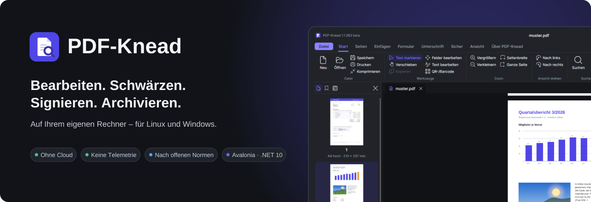

  
  
  
  
  
  
  

<h3 align="center">A PDF program that takes your documents seriously.</h3>

  View, scan, edit, measure, redact, sign, archive – in one program, on your computer. 
  No account. No cloud. No telemetry.

---

## For everyone who wants digital sovereignty

Public administrations, courts, archives and companies that are moving their workstations to open systems need more than a viewer for
PDF: redacting, signing, archiving, filling in forms, checking e-invoices – on Linux just as on Windows. PDF-Knead is built for this.

- **Independent:** Everything runs on your own computer – no account, no cloud, no telemetry, updates only when you want them. PDF-Knead
  goes online only when you trigger it or switch it on, for example for a timestamp.
- **Linux on an equal footing:** one user interface for Linux and Windows, no installation – as an AppImage or as a single `.exe`.
- **Open standards instead of vendor formats:** ISO 32000 (PDF), ISO 19005 (PDF/A) for long-term archiving, PAdES (ETSI EN 319 142)
  for signatures, XRechnung and ZUGFeRD according to EN 16931. Whatever a file contains that PDF-Knead does not understand stays
  unchanged when saving – no lock-in to one program.
- **For everyday administrative work:** Redaction that really deletes – for example for information requests and freedom-of-information
  requests; checking incoming e-invoices; PDF/A for filing, also tagged for low-barrier access; recognising and filling in forms.
- **AI local only:** Text recognition and field recognition work with AI models that are included in the package and run on your own
  computer. No document, no page image and no recognised text is sent to an AI service – this also works entirely without an internet
  connection.
- **No foreign code:** JavaScript in PDFs is never executed.
- **Verifiable:** cross-checked with independent tools, including the KoSIT validation tool, the European Commission's signature service
  and veraPDF ([more on this](#verified-not-claimed)).

---

> **John Warnock** had a simple, big idea with the “Camelot Project”: a document should look the same everywhere – on every
> screen, every printer, every system. That idea became PDF, today the open standard ISO 32000 that authorities, courts and archives work
> with every day. I would have liked to name this program after him; for trademark reasons that was not possible, as the rights to the
> name lie with Adobe. The respect remains – as does the gratitude to everyone who, over decades and without AI tools, created the
> standards, formats and free libraries on which PDF-Knead is built.
>
> **Why PDF-Knead exists.** Two things spurred me on: on Linux I could not find a program that does all of this in one. And software that
> can only be rented by subscription awakened in me the wish to build something of my own and independent. Had there been a good program
> available as a one-time purchase, I would have bought it – and PDF-Knead would probably not exist. For a private individual, however,
> a subscription is not viable: you pay month after month for a tool you only need now and then, and you can no longer edit your own
> documents as soon as you cancel.

---

## Rethought from the ground up

PDF-Knead is not a copy. It has been developed according to the open standards – not through reverse engineering or from the blueprint of
another program. That has consequences, and each one was decided deliberately: its own parser with repair, its own renderer, its own
writer, its own font handling, its own image filters, encryption and compression. Where individual
methods have been taken from openly licensed projects, this is stated together with the licence in
[THIRD-PARTY-NOTICES.md](THIRD-PARTY-NOTICES.md).

PDF-Knead was created entirely through AI orchestration. You use tools where they make sense: anyone could pick up a hammer and chisel –
but not everyone could carve Michelangelo's David out of the stone. With programs created with AI, it is harder to tell whether they are
mature, because today every one of them looks like a “David”. The work lies in understanding process chains and anticipating which way of
operating fits a workflow; then you are more of a conductor than a soloist. So that the end result is not just an application that looks
like a David, every major function has been measured, bombarded with corrupted files and, where independent validation programs exist,
checked against them.

  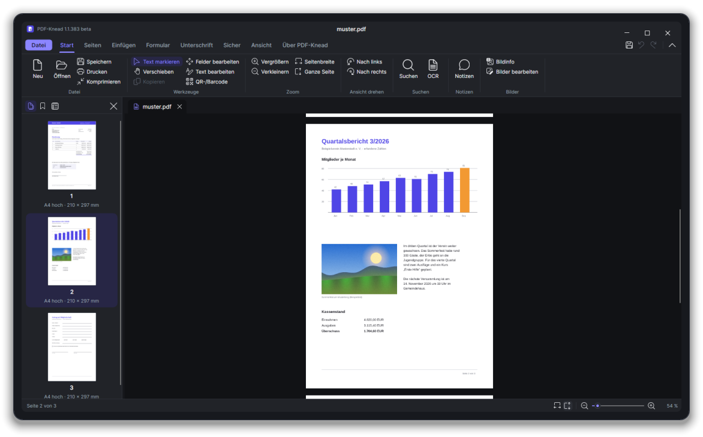

---

## Highlights

  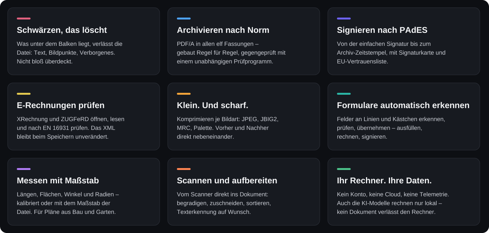

**To try it out: the [sample file](docs/beispiel/pdf-knead-beispiel.pdf).** 15 pages in which every capability is a real part of the
file, not a picture of it: measurements to scale, fillable form fields, QR codes and barcodes, an e-invoice according to EN 16931,
Chinese, Japanese and Korean – also set vertically –, a genuine redaction, saved as PDF/A-3a. All names and data in it are fictitious.

  <a href="docs/beispiel/pdf-knead-beispiel.pdf">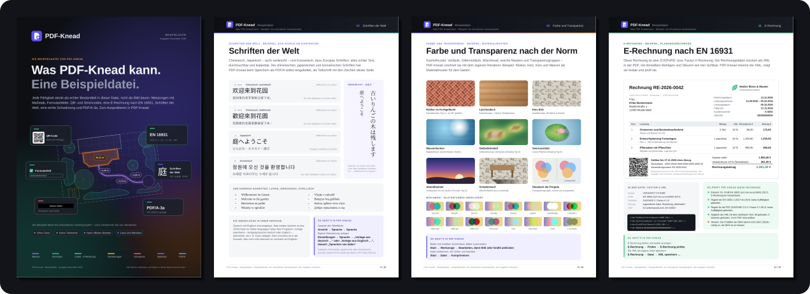</a>

### Redaction that really deletes

A black bar alone protects nothing. PDF-Knead removes what lies underneath – and searches for wherever else it appears.

  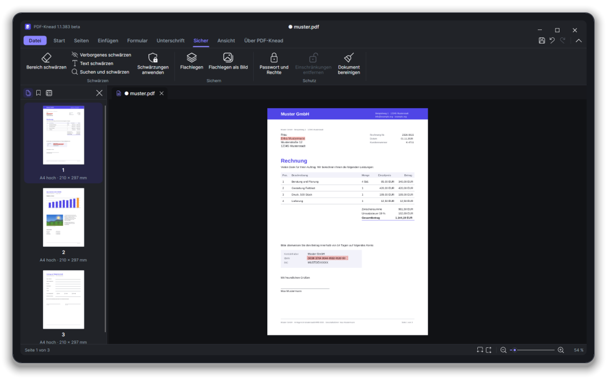

  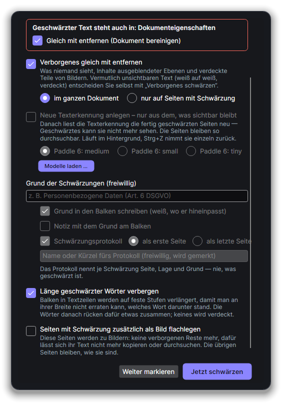
  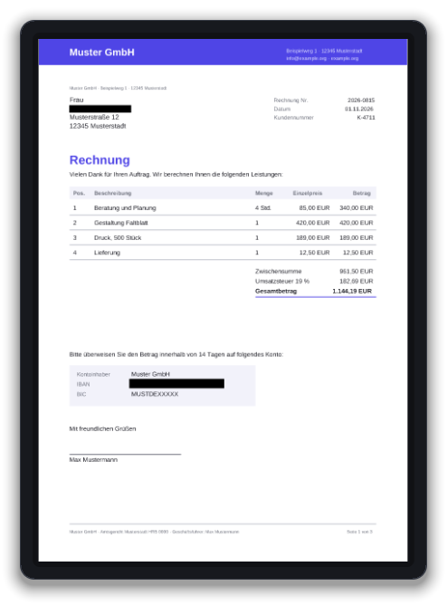

- **Removed, not covered:** Text, graphics, pixels, comments and form fields under the bar leave the file. The bars cut out the area, through all layers – instead of merely pixelating it.
- **Hidden content goes too:** invisible OCR text, hidden layers, covered parts of images. White or tiny text is found.
- **No second occurrence:** metadata, bookmarks, comments, form values, QR codes and barcodes are searched as well.
- **No trace in the spacing:** lines are re-set, and the length of redacted words can be hidden.
- **Detecting others' mistakes:** PDF-Knead reports files that are only seemingly redacted when they are opened.

&nbsp; <b>Research and testing behind redaction</b>

We have gathered around 50 methods of hiding content and over 30 publicly known ways of recovering redacted content from research, court
cases and the trade press, and tested each one individually against PDF-Knead. 
The most important ones:

**Text under the bar** 
Anyone who only covers it leaves the text in the file – copying is enough. PDF-Knead removes text, paths and pixels under the bar.

**Redactions never applied** 
Redaction marks from other programs or black comments only cover. PDF-Knead reports such places as soon as the file is opened.

**Images and their copies** 
An image can be present in the file several times: as an unused copy, as a page thumbnail, as a thumbnail inside the image itself or as an
alternate image. PDF-Knead redacts the pixels, rewrites the image and removes every copy.

**Leftovers after the end of the file** 
Tools that only partially overwrite a file leave old data standing at the end. PDF-Knead rewrites redacted files completely.

**Older versions** 
Appended changes preserve the earlier version, plain text included. After redaction there is exactly one version, containing only what
the pages show.

**Invisible and hidden text** 
White on white, tiny, transparent, outside the page, on hidden layers: PDF-Knead finds and removes 26 kinds of hiding.

**Text recognition under scans** 
The invisible text layer goes too. And because the boxes from text recognition often do not fully enclose the ink, the bar follows the
ink – not a remnant of a letter is left.

**Spacing and lengths** 
The width of what was removed can be calculated from the positions of the remaining characters (Bland et al., PoPETs 2023). PDF-Knead
re-sets the line and hides the length of redacted words. We have rebuilt the attack and use it to measure: without length protection, it
narrows a redacted word down from 300 to around 15 candidates using a list of names; with length protection, around 110 remain. Every
shift is then re-checked on the finished page; where a line does not safely allow it, PDF-Knead says so.

**Fonts and metadata** 
Fonts are cleaned; metadata, bookmarks, comments, form values as well as QR codes and barcodes are searched too.

**Pixelation** 
Pixelated or blurred text can be reconstructed (Hill et al., PoPETs 2016). PDF-Knead only redacts opaquely.

**How it is tested** 
Fixed rules for every case: no character under a bar, nothing visible next to it changed, the redacted words nowhere left in the file.
Over 3,000 cases from four collections, over 1,000 with synthetic personal data, over 1,000 scanned pages with traps, over 3,000 cases
with the mouse in the finished program, over 500,000 fuzzing samples.

**Openly stated** 
PDF-Knead names pages whose text cannot be read – “Redact area” helps there.
Sources include: Bland, Iyer, Levchenko: “Story Beyond the Eye: Glyph Positions Break PDF Text Redaction” (PoPETs 2023);
Hill et al.: Mosaicing and Blurring as Tools for Document Redaction (PoPETs 2016); Mainka, Mladenov, Rohlmann: “Shadow Attacks”
(NDSS 2021); Markwood et al.: “PDF Mirage” (USENIX Security 2017); ISO 32000-2.

### Archiving to standard

For archives and authorities: PDF/A, built rule by rule.

  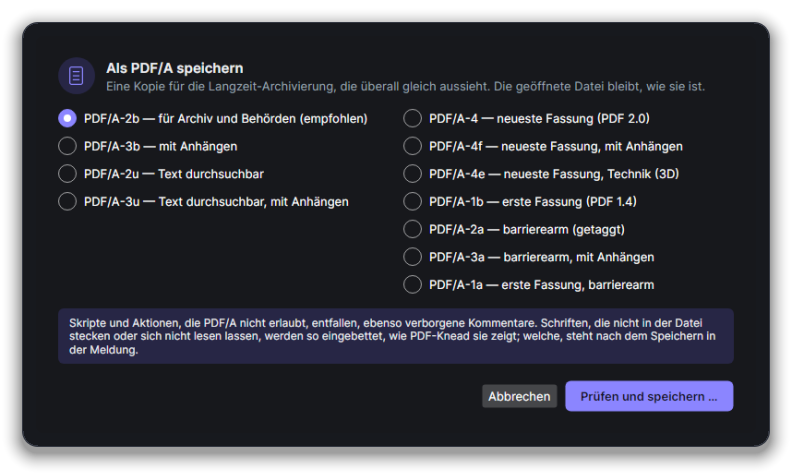

- **All eleven variants** from PDF/A-1 to PDF/A-4 (ISO 19005), also tagged for low-barrier access with language and image descriptions.
- **Starting from the rules:** Each of the roughly 160 individual rules has its own check, a measure when writing and a test.
- **Only what passes is saved.** Otherwise PDF-Knead gives the reasons, with the page and the section of the standard.
- **Cross-checked:** around 5,000 copies of a public layout dataset and almost 1,000 copies each of a public test collection in several
  variants – none rejected by an independent PDF/A validator.

### Signing according to European standards

From a self-generated certificate to a signature card – according to ISO 32000-2 and ETSI EN 319 142 (PAdES).

  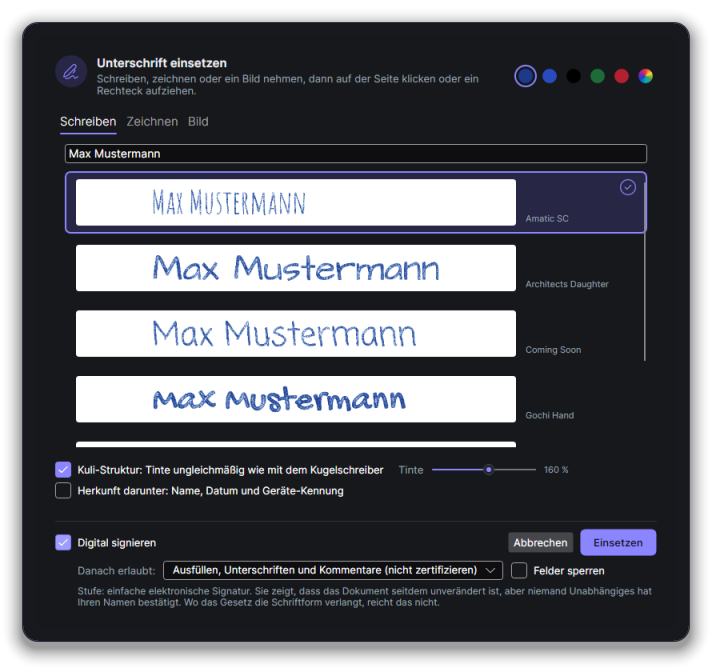
  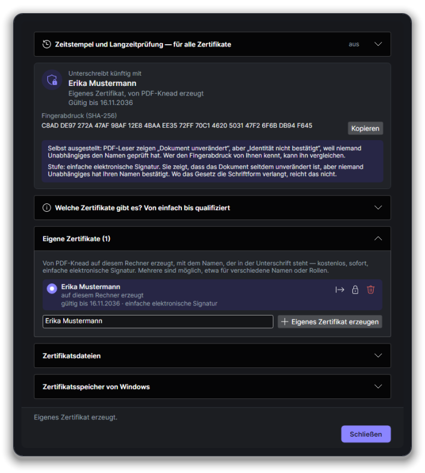

- **Levels B-B to B-LTA:** timestamp (RFC 3161), embedded revocation information, archive timestamp; certifying and locking fields.
- **Your certificate, your choice:** your own certificates (several too, for example for different roles), certificate files, the
  certificate store on Windows, signature cards via PKCS#11 – the key never leaves the card. For each certificate, the window says which
  signature level it reaches and what that means.
- **Verification on opening,** optionally against the EU trusted list; the level is displayed: simple, advanced or qualified.
- **Tested against known attacks** (Universal Signature Forgery, Incremental Saving, Signature Wrapping, Shadow Attacks; [pdf-insecurity.org](https://pdf-insecurity.org)).
- **To be honest:** A qualified electronic signature requires a qualified certificate on a qualified signature creation device, such as
  a signature card. PDF-Knead has not yet been tested with a real qualified card. PDF-Knead makes no statement about the legal effect in
  any individual case.

### Checking e-invoices

  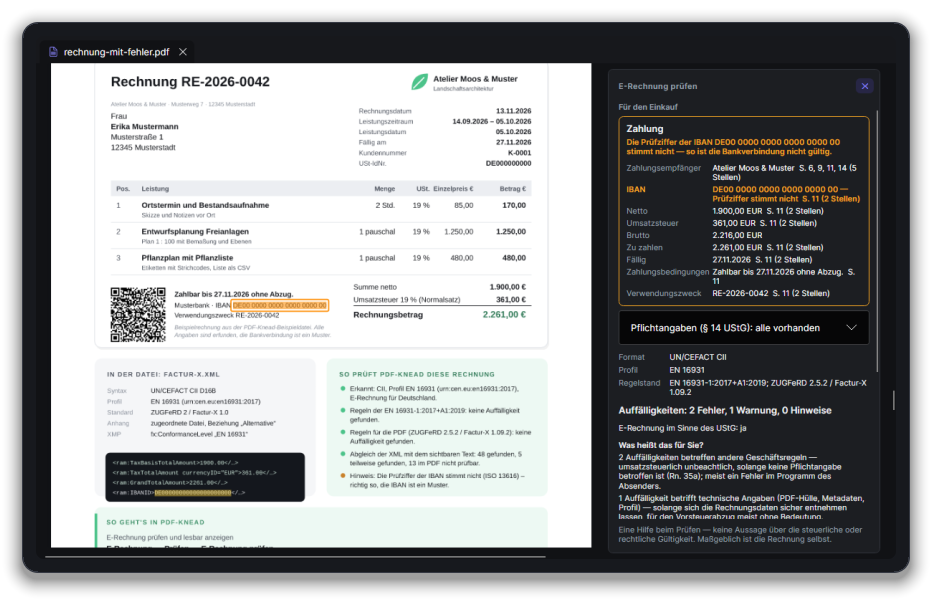

Open, read and check XRechnung and ZUGFeRD/Factur-X – as support, not as a verdict.

- **For purchasing:** payee, IBAN, amounts and due date at a glance – anything conspicuous in the warning colour, marked on the invoice
  with one click. This shows whether the printed amount is the one that is due and whether the bank details can be right.
- **Reading:** the invoice data from the XML, clearly presented. What counts is the structured part, not the image of the invoice.
- **Checking** according to EN 16931 and the XRechnung rules; every result states the version of the rules it is based on. PDF-Knead
  reports anomalies or “no anomaly found” – a validation tool does not replace a tax assessment.
- **Cross-checked** with the KoSIT validation tool and the CEN validation rules: over 14,000 modified invoices without a differing verdict.
- **Stays as it is:** When saving, the embedded XML is never lost and is not changed. PDF-Knead does not create e-invoices
  itself.

**Supported standards and versions:**

- **EN 16931-1:2017** with amendment A1:2019 – the European data model of the e-invoice, checked against its business rules and the
  code lists v18 (valid from 15 November 2026), cross-checked with the CEN validation rules (1.3.17)
  - UN/CEFACT CII D16B
  - UBL 2.1 – invoice and credit note
- **EN 16931-1:2026** – recognised and read, for now checked according to the 2017 rules; rule-by-rule checking follows as soon as the
  standard text and the validation rules are available
- **ZUGFeRD 2.5.2 / Factur-X 1.09.2** – the XML in the PDF/A-3, plus embedding, XMP metadata and file name
  - MINIMUM and BASIC WL – read and displayed, not an e-invoice in Germany
  - BASIC
  - EN 16931 (COMFORT)
  - EXTENDED and EXTENDED-CTC-FR
  - XRECHNUNG
- **Earlier versions** – recognised and checked with the rules of the current version; the identifier in the invoice says which version
  applies
  - ZUGFeRD 2.0 to 2.3 and Factur-X 1.0 to 1.08
  - ZUGFeRD 1.0 (BASIC, COMFORT, EXTENDED) – read and displayed, not an e-invoice in Germany
- **XRechnung 3.0.2** – in CII and UBL, with the Extension and the German business rules BR-DE
  - earlier versions 1.2 to 2.x – recognised, checked according to 3.0
  - XRechnung 4.0 – follows as soon as the final version is published (announced for 2027)
- **Peppol BIS Billing 3.0** (UBL) – recognised, checked according to EN 16931, codes in plain text

### Small. And sharp.

Every kind of image gets its own method – and you see the result before you save.

  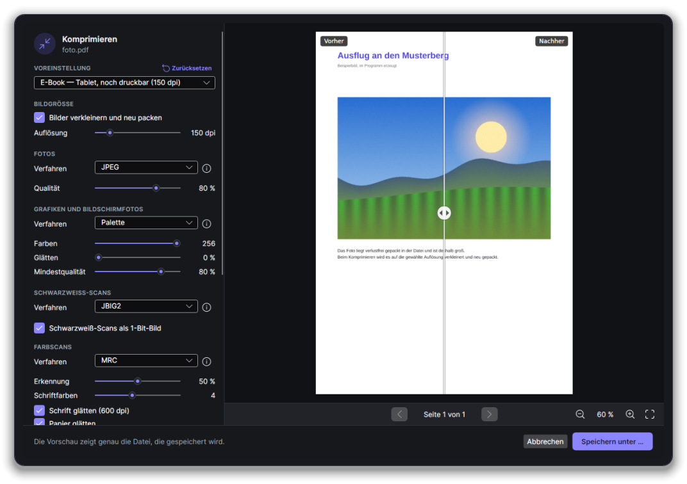

- **Photos** as JPEG, **graphics** with a palette or Flate, **black-and-white scans** as JBIG2 – without pattern matching, so that no digits get swapped.
- **Colour scans with MRC:** text as a sharp mask in the colour and weight of the original, background as JPEG. Measured on three
  scanned letters: around one tenth of the original size.
- **Before/after** with a dividing line, the size known in advance from a real trial run; for each method, which common readers display it.

### Recognising forms automatically

Turn an empty form into a fillable one – PDF-Knead suggests, you decide.

  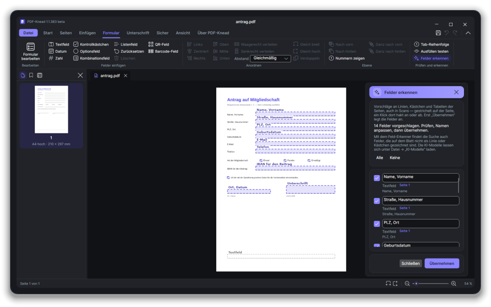
  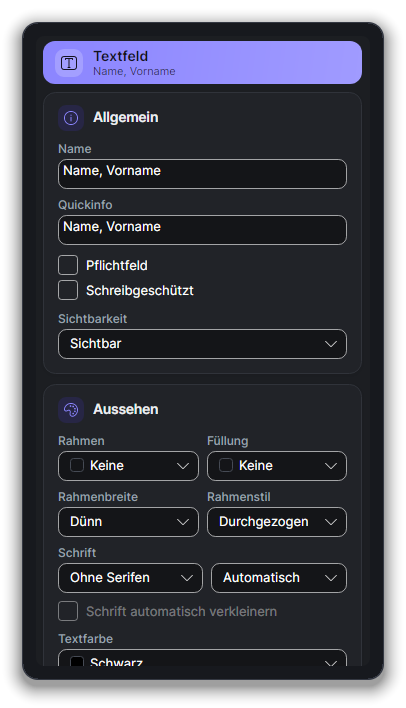

- **Recognise** by lines, boxes and tables, with names taken from the labels. In official forms of German federal authorities, the
  recognition without AI found around 98% of the fields.
- **Create** with all field types, properties, tab order and calculations as formulas. **Fill in** forms from elsewhere too.

### Measuring to scale

For architecture, construction, and garden and landscape design: measure plans as they are drawn.

  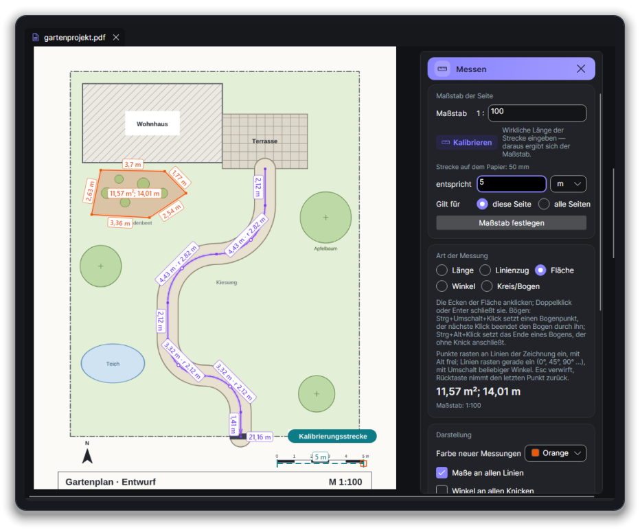

- **Lengths, polylines, areas with perimeter, angles, circles and arcs** – each arc shows its radius, and the area includes the circular segments.
- **With the file's scale** (ISO 32000-2) or calibrated yourself: set the start and end of a known distance with the magnifier, enter the
  length. The scale is written into the page so that other programs measure the same.
- **Placed precisely:** points snap to corners and lines of the drawing, straight lines at 0°, 45° and 90°.
- **Saved as a dimension** according to the PDF standard – with arrows according to ISO 129-1, movable again later, also in dimensions from other programs.

### Scanning and preparing

From the scanner straight into PDF-Knead – on Linux via SANE, on Windows via WIA.

  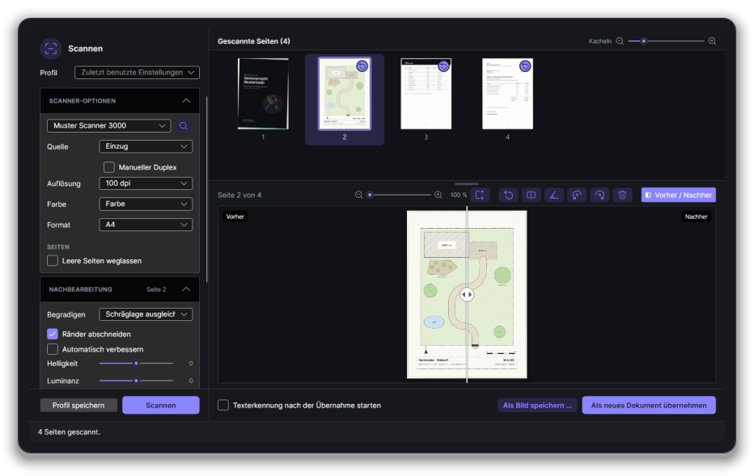

- **Profiles** with all settings, **tiles** for sorting, a large **preview** with before/after.
- **Preparing:** correct skew, flatten book pages at the spine, crop margins, rotate freely – can be discarded for each page.
- **Import** as a new document or append to the open one, with text recognition straight away if you wish.

### Pages under control

Split and merge without losing track: every page can be seen as a preview, every assignment is marked in colour.

  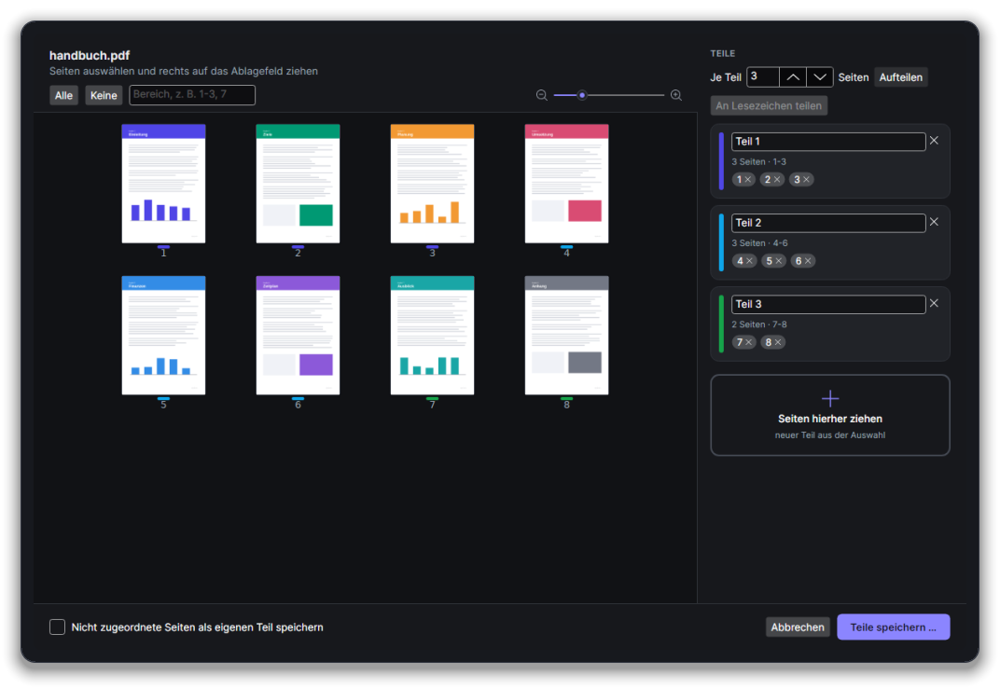

  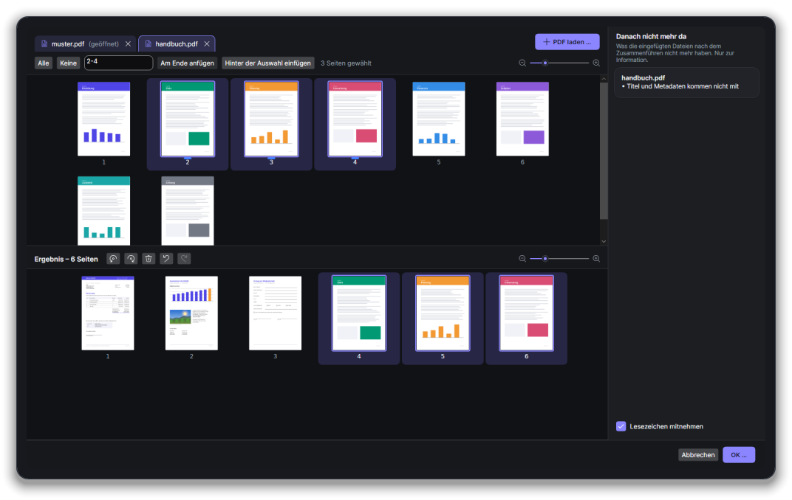

- **Split:** select pages and drag them onto the drop area, split by a fixed number of pages or at bookmarks.
- **Merge:** several PDFs as tabs, pages into the result by click, range or dragging, then sort, rotate and remove them there – with undo.
- **Clearly stated what changes:** a notice box states what no longer applies after merging, such as permissions, passwords or signatures of the sources.
- **Sort** in a large tile view. When merging, the source files remain untouched.

### Printing as a booklet

  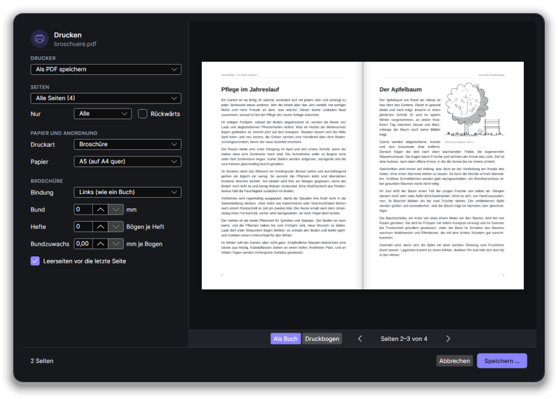

- **Booklet** with a book preview you can page through: A4 sheets become an A5 booklet, with gutter, binding on the left or right, and
  signatures for thick booklets.
- **Poster** across several sheets, **several pages per sheet** – see beforehand what will come out of the printer.

### QR codes and barcodes

  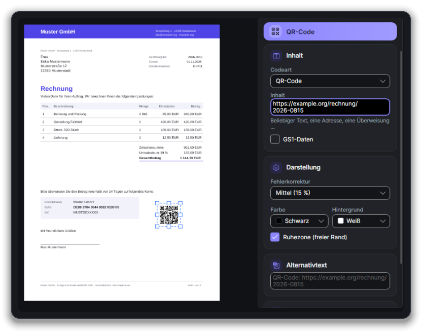

- **Read and understand:** QR, Data Matrix, Code 128, EAN, UPC, Code 39, ITF – including their meaning, such as GiroCode or the Swiss QR-bill.
- **Insert and edit** as vector graphics; every new code is read back as a test.
- **Safe:** contents are never executed, addresses are opened only after confirmation, hidden characters are made visible.

### Managing permissions and passwords

  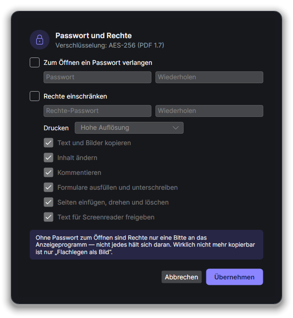

- **Password to open** with AES-256, set **permissions** individually: printing, copying, changing, commenting, forms, pages.
- **Honestly explained:** without a password to open, permissions are only a request to the viewer. Only “Flatten as image” makes
  content truly impossible to copy – PDF-Knead says so in the window too.

### Administrative permissions

  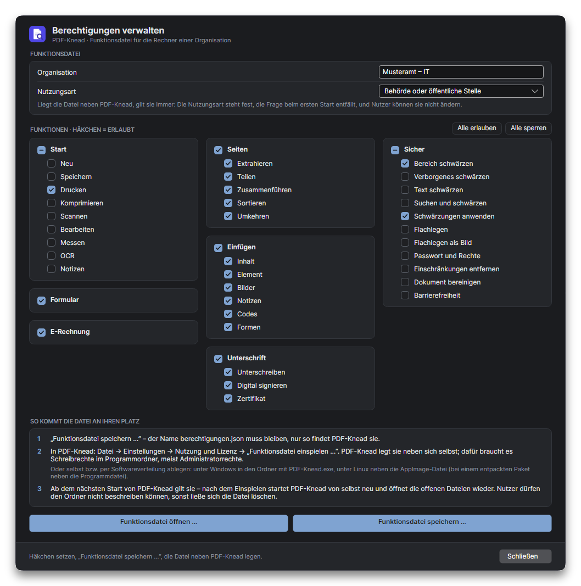
  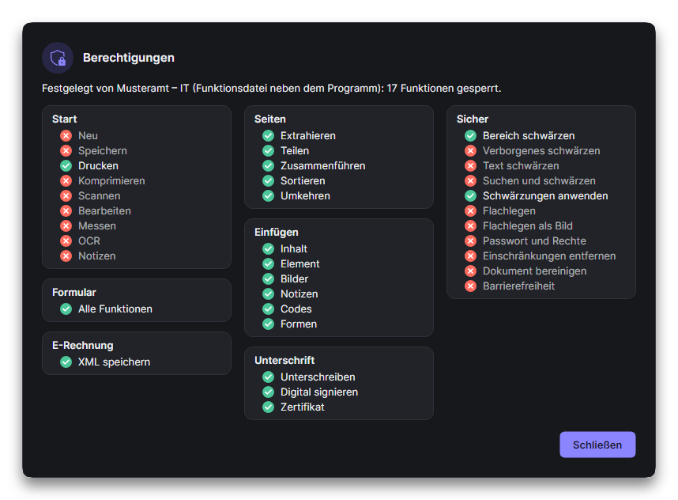

  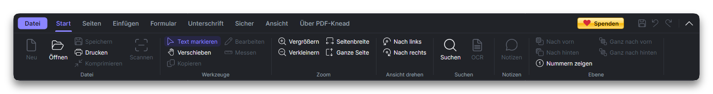
  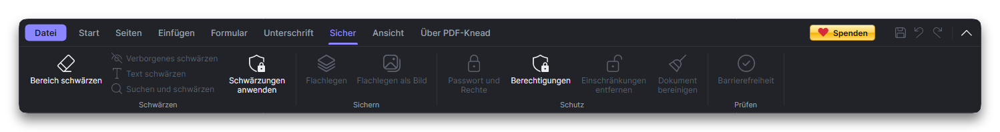

The same function file everywhere: made in the FunktionManager (left), in PDF-Knead under “Show permissions” (right) and on the
ribbon – under “Start” only printing is left, under “Secure” only area redaction and applying redactions. Opening, viewing and searching
always work.

Authorities and larger companies need to decide who may do what: no “Remove restrictions” for case workers, signing with a certificate
only where it is intended, printing only where it is needed. That is what the function file is for – no server, no sign-in, nothing
sent anywhere.

- **One small file beside the program** (`berechtigungen.json`) says which functions are switched off: ordered by the tabs of the
  program, each function on its own, forms as a whole. IT hands it out like any other file.
- **Made with the FunktionManager,** which comes with every package: set the ticks, save, and put it beside the program with
  “Install function file …” in PDF-Knead – PDF-Knead then starts anew by itself. Where users cannot write, it cannot be bypassed – the
  kind of use is then fixed as well.
- **Not tied to licenses:** permissions decide what staff may do, not what has been paid for. They apply to every function, the free
  ones included.
- **Safe when in doubt:** a damaged file switches off every function that can be restricted instead of allowing everything. Opening,
  viewing and checking always work.
- **Visible to everyone:** switched-off buttons are greyed out and say why; under Settings → “Show permissions” everyone sees what
  applies.

### Prepress: seeing overprint

  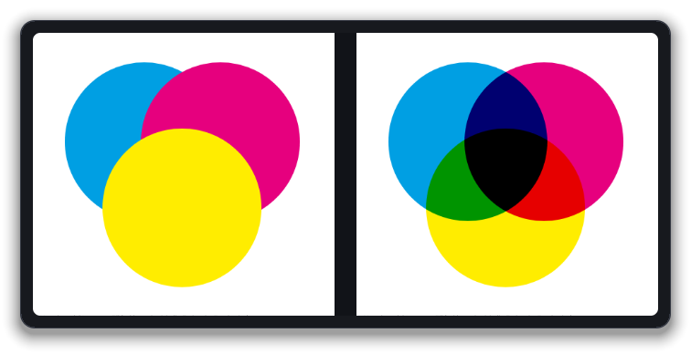

What lies on top of each other in print mixes – on screen you normally do not see it. The **overprint preview** in the
“View” tab shows it (left off, right on). In addition: transparency groups, masks, blend modes and shadings according to the PDF standard.

### Scripts of the world, languages of your choice

- **Chinese, Japanese, Korean:** PDF-Knead displays CJK documents – including vertically set text and files without embedded
  fonts. The predefined CMaps of the standard are built into the program; Noto Sans CJK and Noto Serif CJK are included.
- **When writing, too:** Chinese, Japanese and Korean characters can be typed with the input methods of Linux and Windows. Only a
  small subset font containing the characters that actually occur is saved.
- **The user interface in your language:** German and English are built in. Any further language is a JSON file: export the template,
  translate it, put it in the `languages` folder – and it appears in the selection, with singular and plural, number and date formats.
  Anything not yet translated appears in English.

### Your computer. Your data.

- **Local:** viewing, editing, redacting, compressing, PDF/A and text recognition run on your computer.
- **AI without the cloud:** The AI models for text recognition (PP-OCRv6) and field recognition (FFDetr) are included in the package and
  run directly on your computer, via ONNX Runtime with telemetry switched off. There is no AI service, no account and no downloading of
  anything: your documents, page images and recognised texts do not leave your computer.
- **Quiet:** no telemetry, no account, updates only when you want them – the telemetry of bundled libraries is also switched off in
  the program.
- **No foreign code:** JavaScript in PDFs is never executed; PDF-Knead recalculates form calculations itself.
- **No old versions:** files are saved completely anew – except for signed documents, to which permitted changes are appended.

&nbsp; <b>When PDF-Knead goes online – and only then</b>

**Principle:** PDF-Knead never opens a connection on its own. It goes online only for the following functions – and only when you
trigger them or switch them on.

**Checking for updates** 
*When:* only if you switch it on (default: off; PDF-Knead asks once at the first start), then at start at most once a day;
manually at any time. In administrations, IT can switch it off centrally. 
*What:* only the request for a version file from GitHub – GitHub sees the address of your connection, the time and the program name with
version, nothing about you or your documents. An update is downloaded only after your click and installed only if its signature is
valid.

**Timestamp when signing** 
*When:* only if you switch it on (default: off). 
*What:* only the hash of the signature – not the document.

**Long-term validation and archive timestamp** 
*When:* only when switched on or on click. 
*What:* revocation status queries to the addresses from the certificates; for the archive timestamp, again only a hash.

**EU trusted list** 
*When:* only on click. 
*What:* retrieval of the public lists of the EU and the member states.

**Links from PDFs and QR codes** 
*When:* only after asking you. 
*What:* the address is opened by your default browser; PDF-Knead itself does not connect.

---

## And everything you need every day

| | |
|---|---|
| **View** | fast display even of large construction plans, search, bookmarks, notes, image info, light and dark theme |
| **Pages** | sort by dragging, rotate, delete, insert blank pages – with undo |
| **Edit** | change existing text, insert text, images, shapes and notes, move and crop images on the page |
| **Sign** | handwriting fonts, drawn or as an image, optionally with a ballpoint pen texture |
| **Text recognition** | scanned pages made searchable, locally; around 97% of words read correctly (measured on scanned pages) |
| **Print** | several pages per sheet, booklet with book preview, poster across several sheets |
| **Measure** | lengths, areas, angles and radii to scale, saved as dimensions |
| **Scan** | scanners on Linux and Windows, preparing pages, text recognition |
| **Secure** | sanitize document, flatten, save as image |
| **Command line** | many functions also available as `pdf-knead` |

---

## Verified, not claimed

  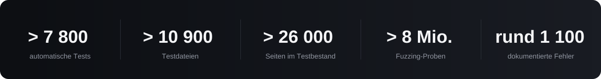

In addition, we are comparing the code with the standards sentence by sentence, starting with ISO 32000-2: every obligation has a place in
the code and a test. Whatever a file contains that PDF-Knead does not understand stays unchanged when saving – so that the program that
wrote it can continue to work with it.

Every accepted milestone ends with an analysis round: security, memory, function, performance – and operation with real
mouse and keyboard events. Every bug found is recorded: cause, solution, what
not to do, and the test that guards against it.

**Cross-checked with independent tools:**

- **[veraPDF](https://verapdf.org)** – PDF/A and PDF/UA. We re-check what PDF-Knead saves as PDF/A with the veraPDF validator:
  in all eleven variants (1a to 4f), across around 3,300 files from public test collections — around 37,000 copies in total — it rejects
  none. On the veraPDF test files (PDF/A-2b), our own
  check rejects none of the 377 valid files and detects all 609 invalid ones.
- **[EU DSS](https://github.com/esig/dss)** (the European Commission's Digital Signature Service) – digital signatures. Our
  signature verification runs over the 251 PDF test files of DSS, and we compare the results file by file with those of DSS. DSS
  recognises files signed by PDF-Knead as valid.
- **[Arlington PDF Model](https://github.com/pdf-association/arlington-pdf-model)** of the PDF Association – the machine-readable model
  of the PDF standard. We check everything PDF-Knead writes (saving, compressing, PDF/A, forms, signing, redacting) against the model with
  its checker.
- **[qpdf](https://github.com/qpdf/qpdf)** – file structure. We additionally check cross-references, object streams, incremental updates,
  filters and encryption of the written files with qpdf as a second, independent reader.
- **[KoSIT validator](https://github.com/itplr-kosit/validator)** with the XRechnung configuration and the
  **[EN 16931 validation rules](https://github.com/ConnectingEurope/eInvoicing-EN16931)** – e-invoicing. We compare the schema and rules
  of our check with these references invoice by invoice: over 14,000 modified invoices without a differing verdict. For invoices according
  to EN 16931-1:2026, the preliminary version of the KoSIT configuration with the UBL 2.5 schema is available; validation rules for 2026
  are not yet publicly available.
- **[Mustang](https://www.mustangproject.org)** – ZUGFeRD and Factur-X: PDF/A-3 and embedded XML as a second cross-check.
- **[ZXing](https://github.com/zxing/zxing)** – barcodes. ZXing reads each of the 14 code types that PDF-Knead generates in four
  rotations with exactly the expected content.
- **[PAC](https://pac.pdf-accessibility.org)** – accessibility according to PDF/UA and the Matterhorn Protocol, as a second checker alongside veraPDF.

The names belong to their owners. The projects have neither tested nor endorsed PDF-Knead – we use their free tools to check
our own work.

&nbsp; <b>What is caught in damaged and crafted files</b>

Whatever PDF-Knead opens may be damaged or deliberately crafted. This is what it catches:

**Broken file structure** 
Damaged cross-references are repaired on opening; cycles in objects, page trees, masks and glyphs are detected.

**Data and memory bombs** 
Limits for nesting, for decompressed data streams and for entries and search text per page – a tiny file cannot flood the
computer.

**Endless pages** 
Time limits for page contents, appearances, images and the code search.

**Crafted fonts** 
Step budgets for font programs (CFF, Type 1, TrueType) and for font layout.

**Crafted images** 
Limits for JBIG2, JPEG 2000, CCITT and PNG; integer overflows caught; stack overflows from deep recursion prevented.

**Injected commands** 
Form values reach scripts only in escaped form; “Sanitize document” removes references to other files and network paths.

**Attacks on signatures** 
Known attack classes, weak algorithms, limited number and size per check.

**XML and metadata** 
Without DTD and external entities; the trusted lists are checked against signature wrapping.

**Files that change behind your back** 
If an open file is truncated or overwritten from outside, PDF-Knead notices and asks.

&nbsp; <b>Measured performance</b>

Measured on the development computer; the values depend on the computer and the document. We do not make comparisons with other programs.

**Program start** 
First image after around 0.3 s.

**Large construction plan** 
An A0 plan with around 780,000 lines is prepared in just over 1 s on first opening and saved as PDF/A in around 2 s.

**Signing a large file** 
Digitally signing 200 MB: around 3 s, using less than half a gigabyte of memory.

**Redaction** 
500 text pages: under half a second, under 1.5 s including sanitizing the whole document.

---

## Support PDF-Knead

> **There is no corporation behind PDF-Knead.** No investor, no advertising, no business with your data – but a single person, with
> their own time and their own money. That the source code is available for anyone to read does not mean it cost nothing: every check,
> every test run across thousands of files, every standard read sentence by sentence costs time and money. And some things cannot be
> replaced by diligence alone.

**What is still missing: standard texts.** PDF-Knead is compared with the standard text sentence by sentence – just as for PDF itself,
PDF/UA and the signature standards. For two areas the texts are still missing; they are only available for purchase:

- **PDF/A – archiving**, from the PDF Association. Today PDF-Knead works from the public rule collections and has every file
  cross-checked by veraPDF; the standard texts are the source of each of these rules.
  - **[ISO 19005-1:2005 – PDF/A-1](https://pdfa.org/resource/iso-19005-1-pdf-a-1/)**: based on PDF 1.4.
  - **[ISO 19005-2:2011 – PDF/A-2](https://pdfa.org/resource/iso-19005-2-pdf-a-2/)**: based on PDF 1.7 (ISO 32000-1).
  - **[ISO 19005-3:2012 – PDF/A-3](https://pdfa.org/resource/iso-19005-pdfa/)**: PDF/A-2 with embedded files – the basis of
    ZUGFeRD and Factur-X.
  - **[ISO 19005-4:2020 – PDF/A-4](https://pdfa.org/resource/iso-19005-4-pdf-a-4/)**: based on PDF 2.0 (ISO 32000-2).
- **E-invoicing according to the 2026 version**, from DIN Media. Since 2026 a revised data model of the European e-invoice has applied,
  and XRechnung 4.0 will implement it in Germany; PDF-Knead already recognises such invoices, but still checks them according to the 2017 rules.
  - **[DIN EN 16931-1:2026-10 – Semantic data model of the electronic invoice](https://www.dinmedia.de/de/norm/din-en-16931-1/400613286)**:
    the core elements of every e-invoice, regardless of format.
  - **[DIN CEN/TS 16931-3-3 – Syntax binding to UN/CEFACT CII](https://www.dinmedia.de/en/pre-standard/din-cen-ts-16931-3-3/308617415)**:
    how the data model is expressed in CII – the basis of ZUGFeRD, Factur-X and XRechnung in CII. The 2026 edition is not yet listed as a
    German version at DIN Media; the link leads to the previous one.

**Why this matters.** What authorities, courts and archives file as PDF/A today must look exactly the same in thirty years as it did on
the first day, and an e-invoice must be checked according to the rules that apply to it. An independent, verifiable tool for this should
not fail because of the cost of a few standard texts.

**How you can help:**

- **Sponsor a standard:** you cover the cost of one of these standards. If you wish, we will name you here.
- **Support the development:** once or regularly.
- **Spread the word:** to administrations, archives, law firms and everyone who wants digital sovereignty.

**Verified, not claimed – help keep it that way.**

The way to support will follow here shortly. Please do not send standard texts: they are licensed to one person, and PDF-Knead only works with lawfully acquired texts.

---

## Getting started

- **Linux:** download the AppImage, make it executable, start it. **Windows:** start the single `.exe`. No installation needed.
- **Build it yourself:** `./publish.sh` (Linux) or `publish.ps1` (Windows) with a .NET 10 SDK.
- **Text recognition and field recognition with AI** run entirely on your computer: the models (PP-OCRv6 small and medium, the field
  detector FFDetr) are in the package in the `ocr` folder next to the program — nothing needs to be downloaded, and no document leaves the computer.

**Development status:** PDF-Knead is a beta.

## Technology

- **User interface:** [Avalonia](https://avaloniaui.net) – one user interface for Linux and Windows, light and dark.
- **Platform:** C# and .NET 10; on your own system as an ahead-of-time compiled program (Native AOT) for a fast start.
- **Own core:** parser, renderer (transparency groups, masks, shadings), writer, fonts (TrueType, OpenType, CFF, Type 1, Type 3,
  CID, colour fonts) with its own text shaper, filters (Flate, LZW, CCITT, JBIG2, JPEG 2000, Brotli), encryption, ICC colour management,
  QR codes and barcodes, PKCS#11. Drawing is done via SkiaSharp.
- **Packages:** Linux x64 as an AppImage, Windows x64 as a single `.exe`.

## Acknowledgements

To the people behind the standards: ISO 32000 (PDF), ISO 19005 (PDF/A), ETSI EN 319 142 (PAdES), ETSI TS 119 612 (trusted lists), EN 16931 (e-invoicing), the
RFCs on CMS, timestamps and revocation information, and the standards for JPEG, JPEG 2000, JBIG2, CCITT, ICC profiles, OpenType and barcodes.

To the free projects that PDF-Knead ships with or downloads on request – among them .NET, Avalonia, SkiaSharp and Skia, HarfBuzz,
CommunityToolkit.Mvvm, ONNX Runtime, the models PP-OCRv6 and FFDetr, the fonts Liberation, Inter and Noto CJK, and the Fluent UI
System Icons. Complete with versions and licences: [THIRD-PARTY-NOTICES.md](THIRD-PARTY-NOTICES.md).

## Licence

PDF-Knead is released under its own licence. Only the text in [LICENSE](LICENSE) is authoritative. Bundled components are subject
to their own licences ([THIRD-PARTY-NOTICES.md](THIRD-PARTY-NOTICES.md)).

---

PDF is an open standard (ISO 32000). Adobe is a trademark of Adobe Inc.; PDF-Knead is not affiliated with Adobe. Linux is
a trademark of Linus Torvalds, Windows a trademark of Microsoft Corporation. Other names mentioned may be trademarks of their respective owners. All
images show self-generated sample documents with fictitious content; graphics and font (Liberation Sans, SIL OFL) come from the
project. Information provided without guarantee; the licence in LICENSE applies.
