**Deutsch** | [English](README.en.md)

  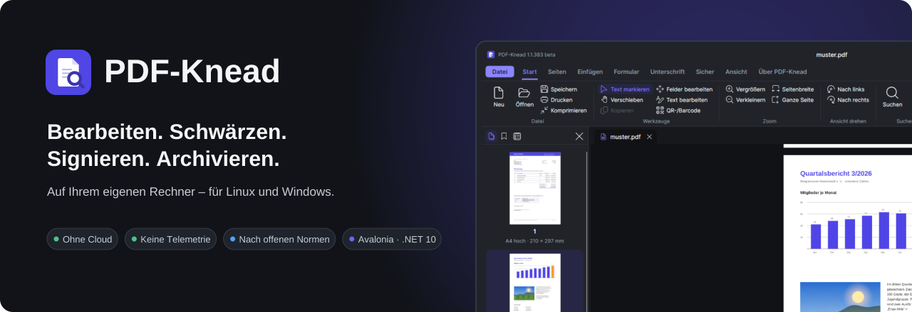

  
  
  
  
  
  
  
  
  

<h3 align="center">Ein PDF-Programm, das Ihre Dokumente ernst nimmt.</h3>

  Ansehen, scannen, bearbeiten, messen, schwärzen, signieren, archivieren – in einem Programm, auf Ihrem Rechner. 
  Ohne Konto. Ohne Cloud. Ohne Telemetrie.

---

## Aus Deutschland. Für Ihre digitale Souveränität.

Verwaltungen, Gerichte, Archive und Unternehmen, die ihre Arbeitsplätze auf offene Systeme umstellen, brauchen für PDF mehr als einen
Betrachter: schwärzen, signieren, archivieren, Formulare ausfüllen, E-Rechnungen prüfen – unter Linux genauso wie unter Windows.
PDF-Knead ist dafür gebaut.

- **Unabhängig:** Alles läuft auf dem eigenen Rechner – ohne Konto, ohne Cloud, ohne Telemetrie, Updates nur, wenn Sie es wollen. Ins
  Netz geht PDF-Knead nur, wenn Sie es auslösen oder einschalten, etwa für einen Zeitstempel.
- **Linux gleichrangig:** eine Oberfläche für Linux und Windows, ohne Installation – als AppImage oder als einzelne `.exe`.
- **Offene Normen statt Herstellerformaten:** ISO 32000 (PDF), ISO 19005 (PDF/A) für die Langzeitarchivierung, PAdES (ETSI EN 319 142)
  für Signaturen, XRechnung und ZUGFeRD nach EN 16931. Was eine Datei enthält und PDF-Knead nicht versteht, bleibt beim Speichern
  unverändert – kein Einschließen in ein Programm.
- **Für den Verwaltungsalltag:** Schwärzen, das wirklich löscht – etwa für Auskunfts- und Informationsfreiheitsanfragen; E-Rechnungen im
  Eingang prüfen; PDF/A für die Ablage, auch barrierearm getaggt; Formulare erkennen und ausfüllen.
- **KI nur lokal:** Texterkennung und Felderkennung arbeiten mit KI-Modellen, die im Paket liegen und auf dem eigenen Rechner rechnen.
  Kein Dokument, kein Seitenbild und kein erkannter Text geht an einen KI-Dienst – das funktioniert auch ganz ohne Internetverbindung.
- **Kein fremder Code:** JavaScript in PDFs wird nie ausgeführt.
- **Nachprüfbar:** gegengeprüft mit unabhängigen Werkzeugen, darunter dem Prüfwerkzeug der KoSIT, dem Signaturdienst der Europäischen
  Kommission und veraPDF ([mehr dazu](#geprüft-nicht-behauptet)).

---

> **John Warnock** hatte mit dem „Camelot Project“ eine einfache, große Idee: Ein Dokument soll überall gleich
> aussehen – auf jedem Bildschirm, jedem Drucker, jedem System. Daraus wurde PDF, heute die offene Norm ISO 32000, mit der Behörden,
> Gerichte und Archive jeden Tag arbeiten. Ich hätte dieses Programm gern nach ihm benannt; aus markenrechtlichen Gründen ging das nicht,
> die Rechte am Namen liegen bei Adobe. Der Respekt bleibt – ebenso wie der Dank an alle, die über Jahrzehnte ohne KI-Werkzeuge die
> Normen, Formate und freien Bibliotheken geschaffen haben, auf denen PDF-Knead steht.
>
> **Warum es PDF-Knead gibt.** Angespornt hat mich zweierlei: Unter Linux habe ich kein Programm gefunden, das all das in einem kann.
> Und Software, die man nur noch im Abo mieten kann, hat in mir den Wunsch geweckt, etwas Eigenes und Unabhängiges zu bauen. Hätte es
> ein gutes Programm zum einmaligen Kauf gegeben, hätte ich es gekauft – und PDF-Knead gäbe es vermutlich nicht. Für eine Privatperson
> aber ist ein Abo nicht tragbar: Man zahlt Monat für Monat für ein Werkzeug, das man nur ab und zu braucht, und kann die eigenen
> Dokumente nicht mehr bearbeiten, sobald man kündigt.

---

## Von Grund auf neu gedacht

PDF-Knead ist kein Nachbau. Es ist nach den offenen Normen entwickelt – nicht durch Reverse Engineering oder nach dem Bauplan eines
fremden Programms. Das hat Folgen, und jede wurde bewusst entschieden: eigener Parser mit Reparatur, eigener Renderer, eigener Writer,
eigene Schriftverarbeitung, eigene Bildfilter, Verschlüsselung und Kompression. Wo einzelne Verfahren aus
offen lizenzierten Projekten übernommen sind, steht das mit Lizenz in [THIRD-PARTY-NOTICES.md](THIRD-PARTY-NOTICES.md).

Entstanden ist PDF-Knead vollständig durch KI-Orchestrierung. Werkzeuge nutzt man, wo sie Sinn ergeben: Hammer und Meißel konnte jeder
in die Hand nehmen – den David von Michelangelo konnte aber nicht jeder aus dem Stein schlagen. Bei Programmen, die mit KI entstehen, ist
schwerer zu erkennen, ob sie ausgereift sind, denn heute sieht jedes aus wie ein „David“. Die Arbeit liegt darin, Prozessketten zu verstehen
und vorauszusehen, welche Bedienung zu einem Arbeitsablauf passt; dann ist man eher Dirigent als Solist. Damit am Ende nicht nur eine
Anwendung steht, die wie ein David aussieht, ist jede größere Funktion gemessen, mit verdorbenen Dateien beschossen und, wo es unabhängige
Prüfprogramme gibt, gegen sie geprüft.

  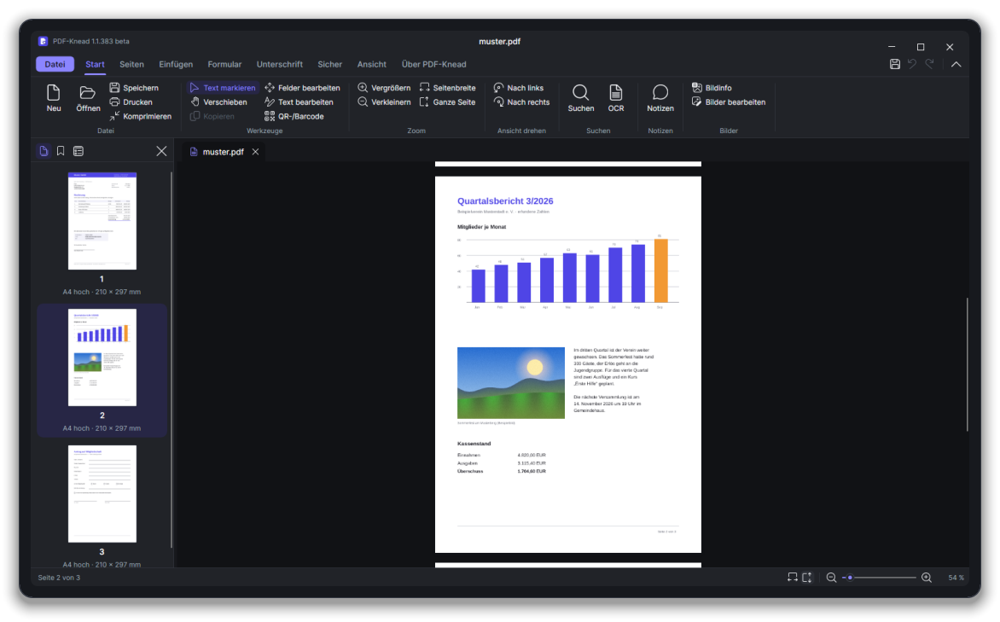

---

## Höhepunkte

  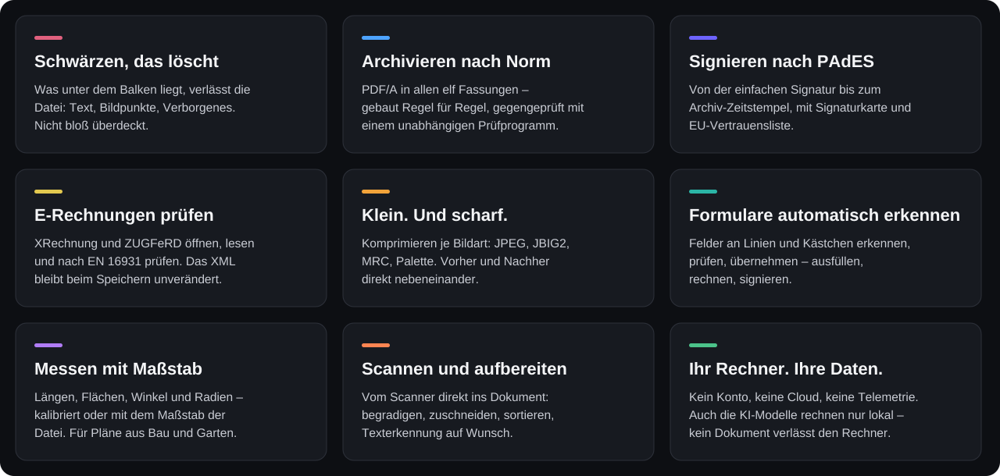

**Zum Ausprobieren: die [Beispieldatei](docs/beispiel/pdf-knead-beispiel.pdf).** 15 Seiten, in denen jede Fähigkeit als echter Bestandteil
der Datei steckt, nicht als Bild davon: Messungen mit Maßstab, ausfüllbare Formularfelder, QR- und Strichcodes, eine E-Rechnung nach
EN 16931, Chinesisch, Japanisch und Koreanisch – auch senkrecht –, eine echte Schwärzung, gespeichert als PDF/A-3a. Alle Namen und Daten
darin sind erfunden.

  <a href="docs/beispiel/pdf-knead-beispiel.pdf">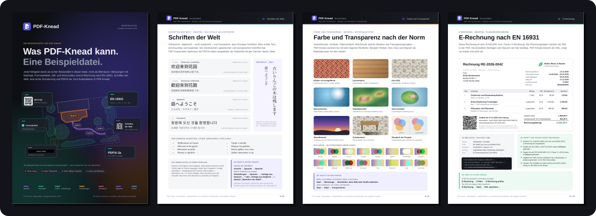</a>

### Schwärzen, das wirklich löscht

Ein schwarzer Balken allein schützt nichts. PDF-Knead entfernt, was darunter liegt – und sucht, wo es sonst noch steht.

  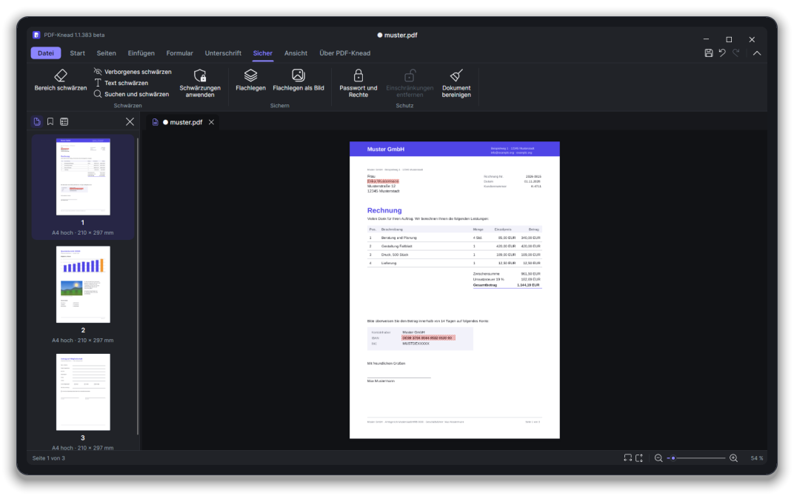

  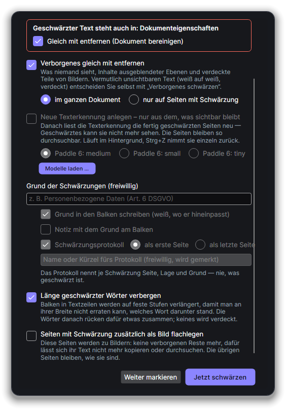
  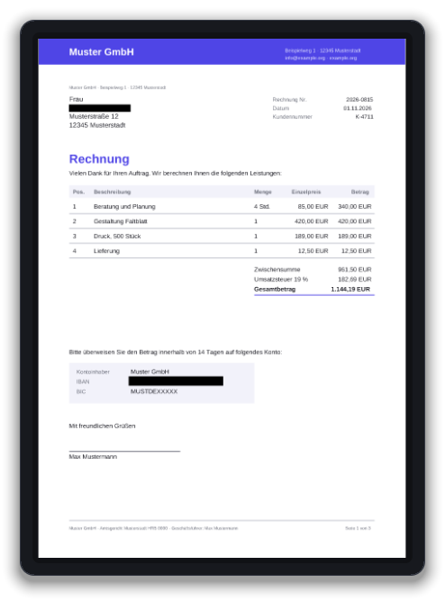

- **Entfernt, nicht überdeckt:** Text, Grafik, Bildpunkte, Kommentare und Formularfelder unter dem Balken verlassen die Datei. Die Balken stanzen den Bereich aus, durch alle Ebenen – statt ihn nur zu verpixeln.
- **Verborgenes geht mit:** unsichtbare Texterkennung, ausgeblendete Ebenen, verdeckte Bildteile. Weißer oder winziger Text wird gefunden.
- **Keine zweite Fundstelle:** Metadaten, Lesezeichen, Kommentare, Formularwerte, QR- und Strichcodes werden mit durchsucht.
- **Keine Spur in den Abständen:** Zeilen werden neu gesetzt, die Länge geschwärzter Wörter lässt sich verbergen.
- **Fremde Fehler erkennen:** Nur scheinbar geschwärzte Dateien meldet PDF-Knead beim Öffnen.

&nbsp; <b>Recherche und Prüfung hinter dem Schwärzen</b>

Rund 50 Methoden, Inhalte zu verstecken, und über 30 öffentlich bekannte Wege, Geschwärztes zurückzuholen, haben wir aus Forschung,
Gerichtsfällen und Fachpresse zusammengetragen und jede einzeln gegen PDF-Knead geprüft. 
Die wichtigsten:

**Text unter dem Balken** 
Wer nur überdeckt, lässt den Text in der Datei – Kopieren genügt. PDF-Knead entfernt Text, Pfade und Bildpunkte unter dem Balken.

**Nie angewendete Schwärzungen** 
Schwärzungsmarken anderer Programme oder schwarze Kommentare verdecken nur. PDF-Knead meldet solche Stellen schon beim Öffnen.

**Bilder und ihre Kopien** 
Ein Bild kann mehrfach in der Datei liegen: als ungenutzte Kopie, Vorschaubild der Seite, Miniatur im Bild selbst oder Ersatzbild.
PDF-Knead schwärzt die Pixel, schreibt das Bild neu und entfernt jede Kopie.

**Reste hinter dem Dateiende** 
Werkzeuge, die eine Datei nur teilweise überschreiben, lassen alte Daten am Ende stehen. PDF-Knead schreibt geschwärzte Dateien
vollständig neu.

**Ältere Fassungen** 
Angehängte Änderungen bewahren die frühere Fassung samt Klartext. Nach dem Schwärzen gibt es genau eine Fassung, nur mit dem, was die
Seiten zeigen.

**Unsichtbarer und verdeckter Text** 
Weiß auf Weiß, winzig, durchsichtig, außerhalb der Seite, auf ausgeblendeten Ebenen: 26 Versteckarten findet und entfernt PDF-Knead.

**Texterkennung unter Scans** 
Die unsichtbare Textschicht geht mit. Und weil die Kästen der Texterkennung die Tinte oft nicht ganz umschließen, richtet sich der Balken
nach der Tinte – kein Buchstabenrest bleibt stehen.

**Abstände und Längen** 
Aus den Positionen der übrigen Zeichen lässt sich die Breite des Entfernten berechnen (Bland u. a., PoPETs 2023). PDF-Knead setzt die
Zeile neu und verbirgt die Länge geschwärzter Wörter. Wir haben den Angriff nachgebaut und messen damit: Ohne Längenschutz grenzt er ein
geschwärztes Wort mit einer Namensliste von 300 auf rund 15 Kandidaten ein, mit Längenschutz bleiben ihm rund 110. Jede Verschiebung wird
danach an der fertigen Seite nachgeprüft; wo eine Zeile es nicht sicher zulässt, sagt PDF-Knead es.

**Schriften und Metadaten** 
Schriften werden bereinigt; Metadaten, Lesezeichen, Kommentare, Formularwerte sowie QR- und Strichcodes mit durchsucht.

**Verpixeln** 
Verpixelter oder weichgezeichneter Text lässt sich zurückrechnen (Hill u. a., PoPETs 2016). PDF-Knead schwärzt nur deckend.

**So wird geprüft** 
Feste Regeln für jeden Fall: kein Zeichen unter einem Balken, nichts Sichtbares daneben verändert, die geschwärzten Wörter nirgends mehr
in der Datei. Über 3 000 Fälle aus vier Beständen, über 1 000 mit synthetischen Personendaten, über 1 000 gescannte Seiten mit Fallen,
über 3 000 Fälle mit der Maus im fertigen Programm, über 500 000 Fuzzing-Proben.

**Offen benannt** 
Seiten, deren Text sich nicht lesen lässt, nennt PDF-Knead – dort hilft „Bereich schwärzen“.
Quellen u. a.: Bland, Iyer, Levchenko: „Story Beyond the Eye: Glyph Positions Break PDF Text Redaction“ (PoPETs 2023);
Hill u. a.: Mosaicing and Blurring as Tools for Document Redaction (PoPETs 2016); Mainka, Mladenov, Rohlmann: „Shadow Attacks“
(NDSS 2021); Markwood u. a.: „PDF Mirage“ (USENIX Security 2017); ISO 32000-2.

### Rechte und Passwörter verwalten

  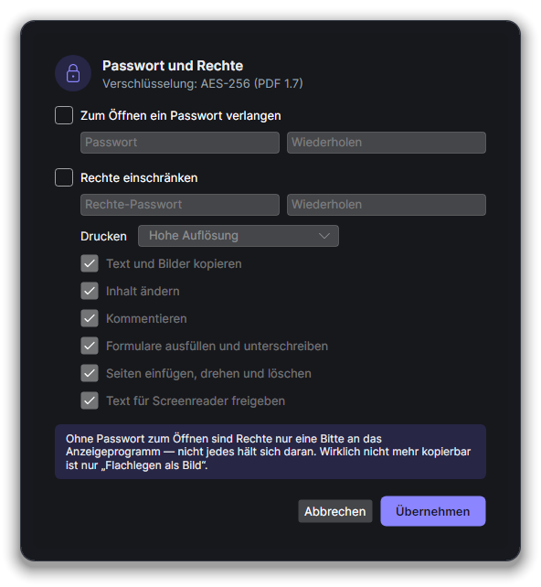

- **Passwort zum Öffnen** mit AES-256, **Rechte** einzeln festlegen: Drucken, Kopieren, Ändern, Kommentieren, Formulare, Seiten.
- **Ehrlich erklärt:** Ohne Passwort zum Öffnen sind Rechte nur eine Bitte an das Anzeigeprogramm. Wirklich nicht mehr kopierbar ist nur
  „Flachlegen als Bild“ – das sagt PDF-Knead auch im Fenster.

### Administrative Berechtigungen

  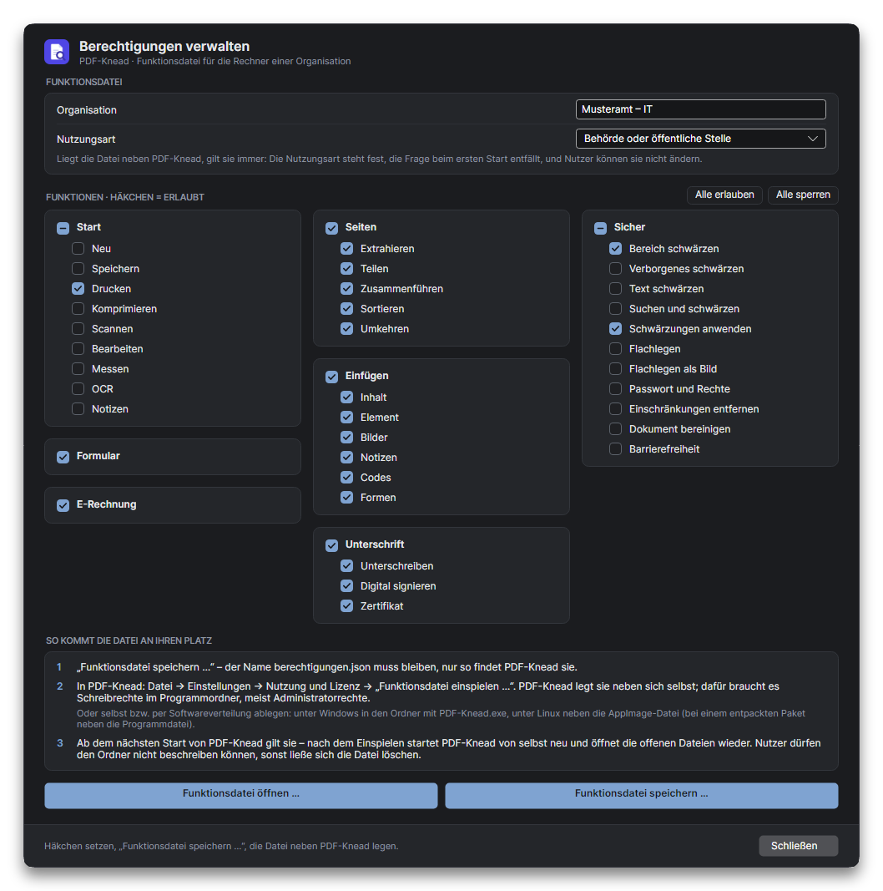
  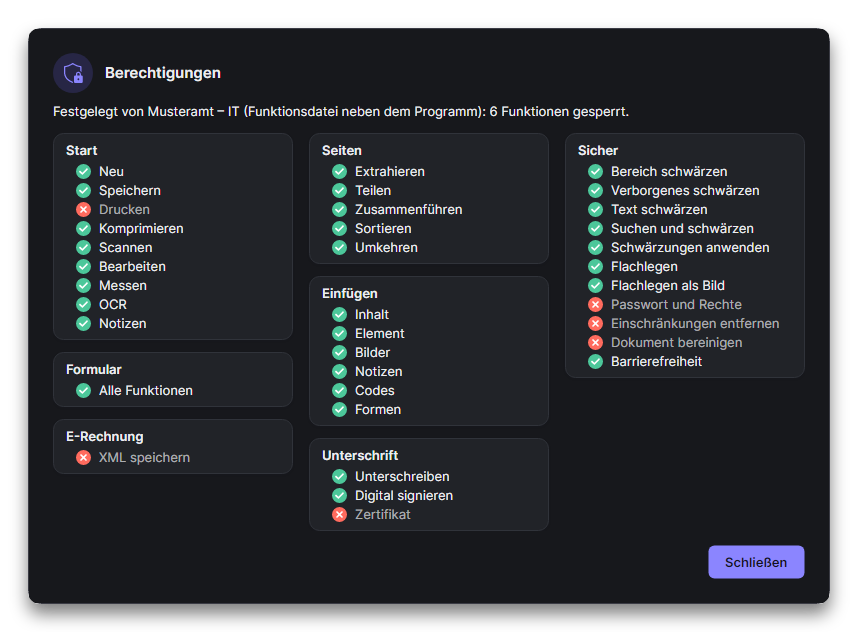

  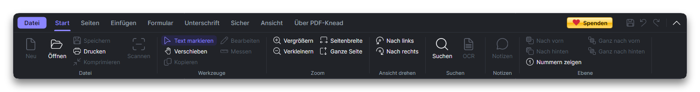
  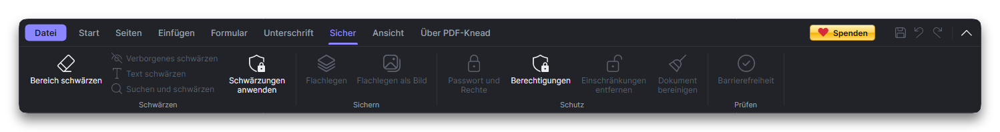

Dieselbe Funktionsdatei überall: im FunktionManager erstellt (links), in PDF-Knead unter „Berechtigungen anzeigen“ (rechts) und auf
dem Menüband – unter „Start“ bleibt nur „Drucken“, unter „Sicher“ nur „Bereich schwärzen“ und „Schwärzungen anwenden“. Öffnen, Ansehen
und Suchen gehen immer.

Behörden und größere Firmen müssen festlegen können, wer was darf: keine „Einschränkungen entfernen“ in der Sachbearbeitung, Signieren
mit Zertifikat nur, wo es vorgesehen ist, Drucken nur, wo es gebraucht wird. Dafür gibt es die Funktionsdatei – ohne Server, ohne
Anmeldung, ohne dass etwas gesendet wird.

- **Eine kleine Datei neben dem Programm** (`berechtigungen.json`) legt fest, welche Funktionen gesperrt sind: geordnet nach den Reitern
  des Programms, jede Funktion einzeln, Formulare als Ganzes. Die IT verteilt sie wie jede andere Datei.
- **Mit dem FunktionManager erstellt,** der jedem Paket beiliegt: Häkchen setzen, speichern, in PDF-Knead mit „Funktionsdatei
  einspielen …“ neben das Programm legen – PDF-Knead startet danach von selbst neu. Wo Nutzer nicht schreiben dürfen, lässt sie sich
  nicht umgehen.
- **Für alle Funktionen:** Berechtigungen regeln, was Mitarbeiter dürfen. PDF-Knead selbst ist für alle kostenlos, auch in Firmen und
  Behörden.
- **Im Zweifel sicher:** Eine beschädigte Datei sperrt alle einschränkbaren Funktionen, statt alles zu erlauben. Öffnen, Ansehen und
  Prüfen gehen immer.
- **Für jeden sichtbar:** Gesperrte Knöpfe sind ausgegraut und sagen, warum; unter Einstellungen → „Nutzungsberechtigung“ →
  „Berechtigungen anzeigen“ sieht jeder, was gilt.

### Archivieren nach Norm

Für Archive und Behörden: PDF/A, gebaut Regel für Regel.

  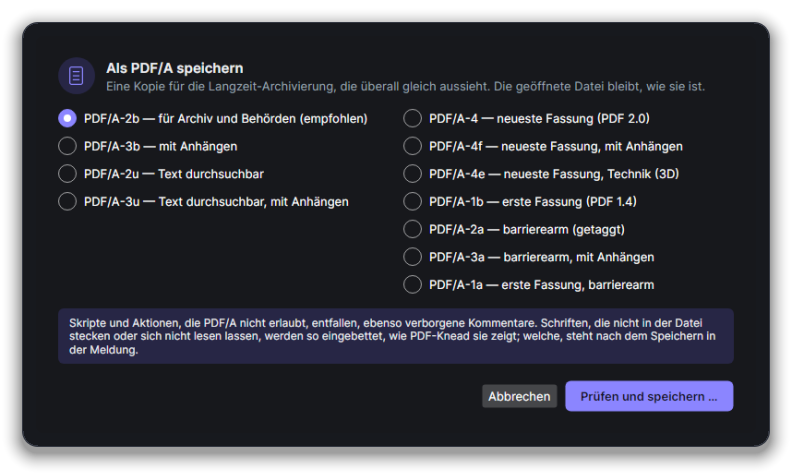

- **Alle elf Fassungen** von PDF/A-1 bis PDF/A-4 (ISO 19005), auch barrierearm getaggt mit Sprache und Bildbeschreibungen.
- **Vom Regelwerk her:** Jede der rund 160 Einzelregeln hat eine eigene Prüfung, eine Maßnahme beim Schreiben und einen Test.
- **Nur, was besteht, wird gespeichert.** Sonst nennt PDF-Knead die Gründe mit Seite und Abschnitt der Norm.
- **Gegengeprüft:** rund 5 000 Kopien eines öffentlichen Layout-Datensatzes und je fast 1 000 Kopien eines öffentlichen Testbestands in
  mehreren Fassungen – von einem unabhängigen PDF/A-Prüfprogramm keine abgelehnt.

### Signieren nach europäischen Normen

Vom selbst erzeugten Zertifikat bis zur Signaturkarte – nach ISO 32000-2 und ETSI EN 319 142 (PAdES).

  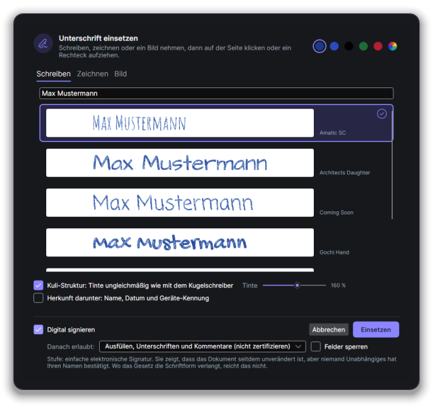
  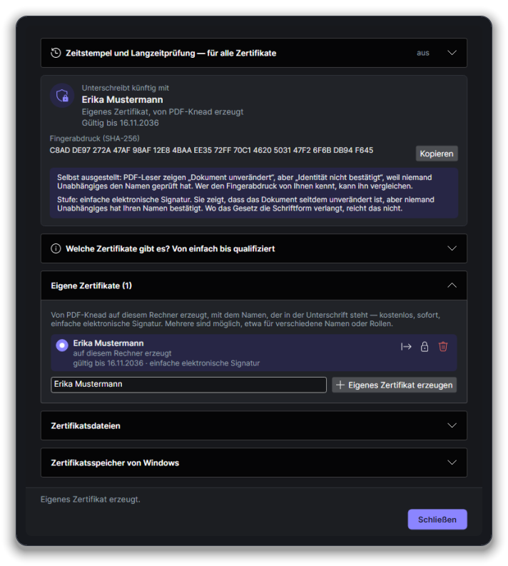

- **Stufen B-B bis B-LTA:** Zeitstempel (RFC 3161), eingebettete Sperrinformationen, Archiv-Zeitstempel; Zertifizieren und Felder sperren.
- **Ihr Zertifikat, Ihre Wahl:** eigene Zertifikate (auch mehrere, etwa für verschiedene Rollen), Zertifikatsdateien, unter Windows der
  Zertifikatsspeicher, Signaturkarten über PKCS#11 – der Schlüssel verlässt die Karte nie. Das Fenster sagt zu jedem Zertifikat, welche
  Stufe der Signatur es erreicht und was das bedeutet.
- **Prüfen beim Öffnen,** auf Wunsch mit der EU-Vertrauensliste; angezeigt wird die Stufe: einfach, fortgeschritten oder qualifiziert.
- **Gegen bekannte Angriffe geprüft** (Universal Signature Forgery, Incremental Saving, Signature Wrapping, Shadow Attacks; [pdf-insecurity.org](https://pdf-insecurity.org)).
- **Ehrlich gesagt:** Eine qualifizierte elektronische Signatur braucht ein qualifiziertes Zertifikat auf einer qualifizierten
  Signaturerstellungseinheit, etwa einer Signaturkarte. Mit einer echten qualifizierten Karte ist PDF-Knead noch nicht erprobt. Über die
  Rechtswirkung im Einzelfall trifft PDF-Knead keine Aussage.

### E-Rechnungen prüfen

  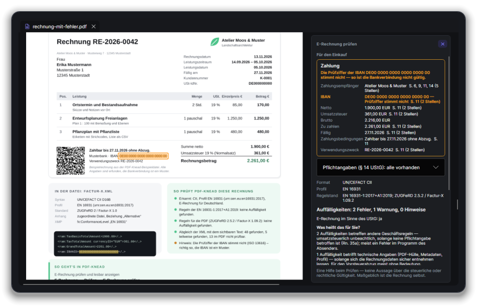

XRechnung und ZUGFeRD/Factur-X öffnen, lesen und prüfen – als Unterstützung, nicht als Urteil.

- **Für den Einkauf:** Zahlungsempfänger, IBAN, Beträge und Fälligkeit auf einen Blick – Auffälliges in der Warnfarbe, mit einem Klick auf
  der Rechnung markiert. So sieht man, ob der gedruckte Betrag der fällige ist und ob die Bankverbindung stimmen kann.
- **Lesen:** die Rechnungsdaten aus dem XML, übersichtlich aufbereitet. Maßgeblich ist der strukturierte Teil, nicht das Bild der Rechnung.
- **Prüfen** nach EN 16931 und den Regeln von XRechnung; jedes Ergebnis nennt seinen Regelstand. PDF-Knead meldet Auffälligkeiten oder
  „keine Auffälligkeit gefunden“ – ein Prüfwerkzeug ersetzt keine steuerliche Beurteilung.
- **Gegengeprüft** mit dem Prüfwerkzeug der KoSIT und den Prüfregeln des CEN: über 14 000 abgewandelte Rechnungen ohne abweichendes Urteil.
- **Bleibt, wie es ist:** Beim Speichern geht das eingebettete XML nie verloren und wird nicht verändert. PDF-Knead erstellt selbst keine
  E-Rechnungen.

**Unterstützte Normen und Fassungen:**

- **EN 16931-1:2017** mit Änderung A1:2019 – das europäische Datenmodell der E-Rechnung, geprüft nach ihren Geschäftsregeln und den
  Codelisten v18 (gültig ab 15.11.2026), gegengeprüft mit den Prüfregeln des CEN (1.3.17)
  - UN/CEFACT CII D16B
  - UBL 2.1 – Rechnung und Gutschrift
- **EN 16931-1:2026** – erkannt und gelesen, geprüft vorerst nach den Regeln von 2017; die Prüfung Regel für Regel folgt, sobald Normtext
  und Prüfregeln vorliegen
- **ZUGFeRD 2.5.2 / Factur-X 1.09.2** – das XML in der PDF/A-3, dazu Einbettung, XMP-Angaben und Dateiname
  - MINIMUM und BASIC WL – gelesen und angezeigt, in Deutschland keine E-Rechnung
  - BASIC
  - EN 16931 (COMFORT)
  - EXTENDED und EXTENDED-CTC-FR
  - XRECHNUNG
- **Frühere Fassungen** – erkannt und mit den Regeln der aktuellen Fassung geprüft; welche Fassung gilt, sagt die Kennung in der Rechnung
  - ZUGFeRD 2.0 bis 2.3 und Factur-X 1.0 bis 1.08
  - ZUGFeRD 1.0 (BASIC, COMFORT, EXTENDED) – gelesen und angezeigt, in Deutschland keine E-Rechnung
- **XRechnung 3.0.2** – in CII und UBL, mit Erweiterung (Extension) und den deutschen Geschäftsregeln BR-DE
  - frühere Fassungen 1.2 bis 2.x – erkannt, geprüft nach 3.0
  - XRechnung 4.0 – folgt, sobald die endgültige Fassung erscheint (angekündigt für 2027)
- **Peppol BIS Billing 3.0** (UBL) – erkannt, geprüft nach EN 16931, Codes in Klartext

### Scannen und aufbereiten

Vom Scanner direkt in PDF-Knead – unter Linux über SANE, unter Windows über WIA.

  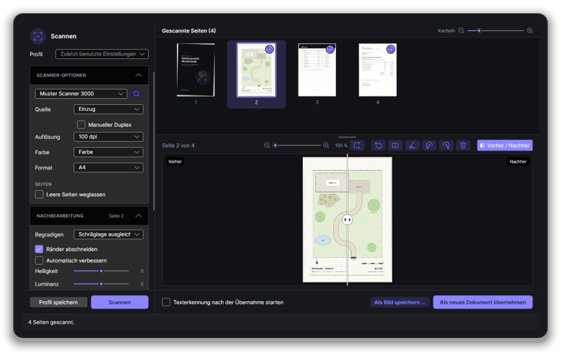

- **Profile** mit allen Einstellungen, **Kacheln** zum Sortieren, eine große **Vorschau** mit Vorher/Nachher.
- **Aufbereiten:** Schräglage ausgleichen, Buchseiten am Bund entzerren, Ränder abschneiden, frei drehen – je Seite verwerfbar.
- **Übernehmen** als neues Dokument oder ans offene anhängen, auf Wunsch gleich mit Texterkennung.

### Formulare automatisch erkennen

Aus einem leeren Formular ein ausfüllbares machen – PDF-Knead schlägt vor, Sie entscheiden.

  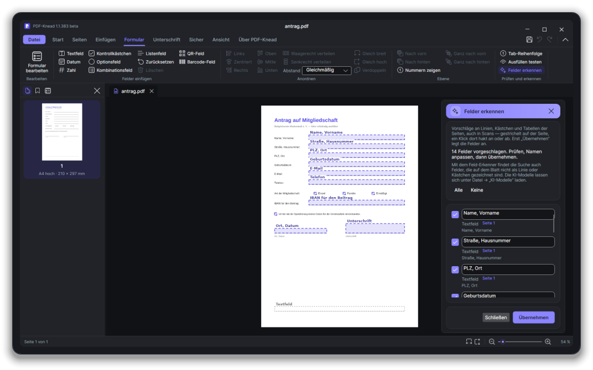
  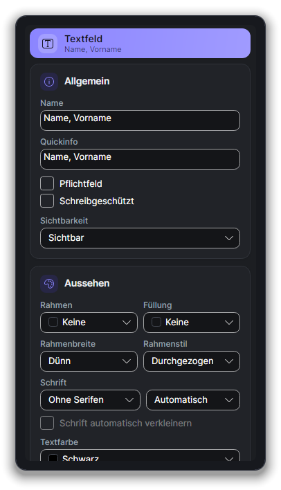

- **Erkennen** an Linien, Kästchen und Tabellen, mit Namen aus der Beschriftung. In amtlichen Formularen deutscher Bundesbehörden fand
  die Erkennung ohne KI rund 98 % der Felder.
- **Erstellen** mit allen Feldarten, Eigenschaften, Tab-Reihenfolge und Berechnungen als Formel. **Ausfüllen** auch fremder Formulare.

### Seiten im Griff

Teilen und zusammenführen, ohne den Überblick zu verlieren: Jede Seite ist als Vorschau zu sehen, jede Zuordnung farbig markiert.

  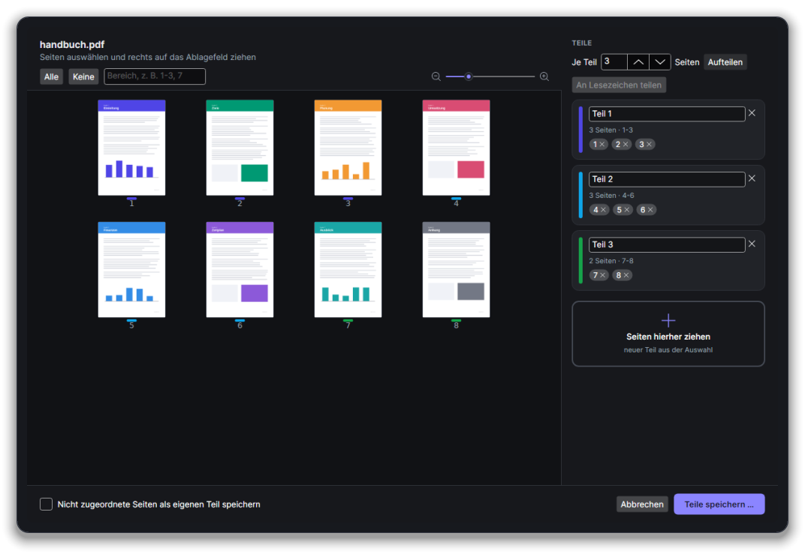

  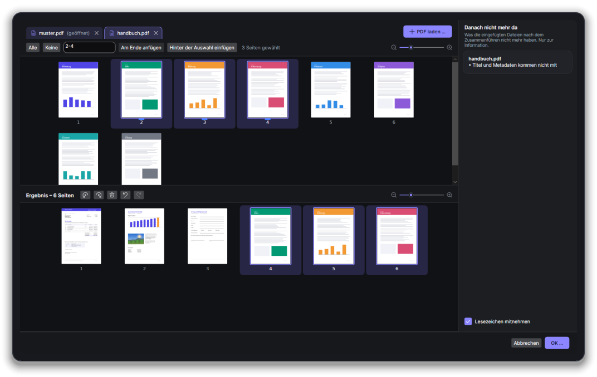

- **Teilen:** Seiten wählen und auf das Ablagefeld ziehen, nach fester Seitenzahl aufteilen oder an Lesezeichen trennen.
- **Zusammenführen:** mehrere PDFs als Reiter, Seiten per Klick, Bereich oder Ziehen ins Ergebnis, dort sortieren, drehen, entfernen – mit Rückgängig.
- **Klar gesagt, was sich ändert:** Ein Hinweisfeld nennt, was nach dem Zusammenführen nicht mehr gilt, etwa Rechte, Passwörter oder Signaturen der Quellen.
- **Sortieren** in einer großen Kachelansicht. Beim Zusammenführen bleiben die Quelldateien unberührt.

### Klein. Und scharf.

Jede Bildart bekommt ihr Verfahren – und Sie sehen das Ergebnis, bevor Sie speichern.

  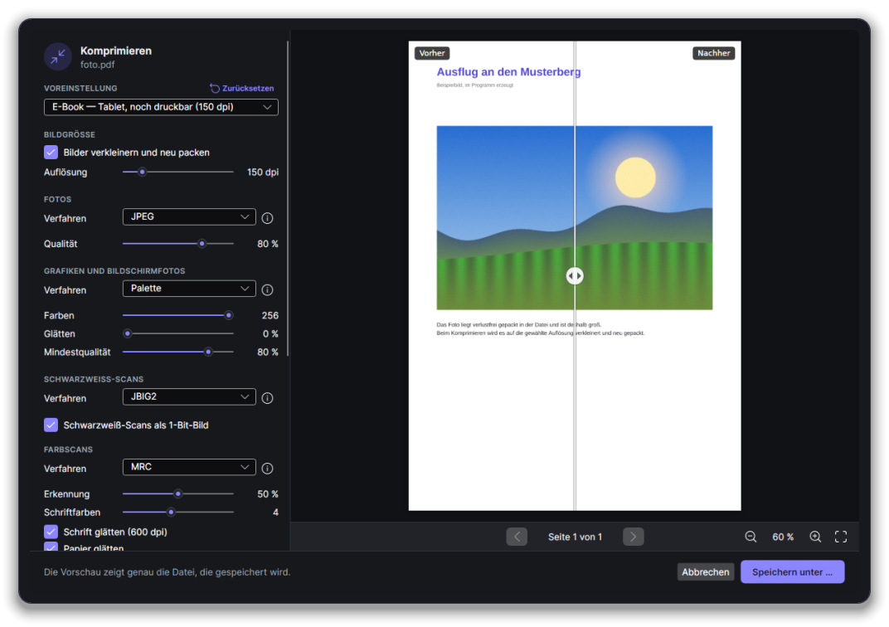

- **Fotos** als JPEG, **Grafiken** mit Palette oder Flate, **Schwarzweiß-Scans** als JBIG2 – ohne Mustervergleich, damit keine Ziffern vertauscht werden.
- **Farbscans mit MRC:** Schrift als scharfe Maske in der Farbe und Kräftigkeit des Originals, Hintergrund als JPEG. Gemessen an drei
  Briefscans: rund ein Zehntel der Originalgröße.
- **Vorher/Nachher** mit Trennlinie, die Größe vorab aus einem echten Probelauf; je Verfahren, welche verbreiteten Leser es anzeigen.

### QR- und Strichcodes

  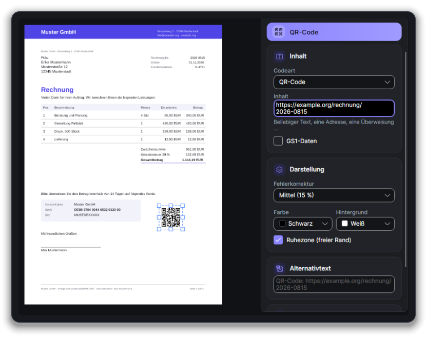

- **Lesen und verstehen:** QR, Data Matrix, Code 128, EAN, UPC, Code 39, ITF – samt Bedeutung wie GiroCode oder Schweizer QR-Rechnung.
- **Einfügen und ändern** als Vektorgrafik; jeder neue Code wird zur Probe gelesen.
- **Sicher:** Inhalte werden nie ausgeführt, Adressen nur nach Rückfrage geöffnet, versteckte Zeichen sichtbar gemacht.

### Messen mit Maßstab

Für Architektur, Bau sowie Garten- und Landschaftsbau: Pläne nachmessen, wie sie gezeichnet sind.

  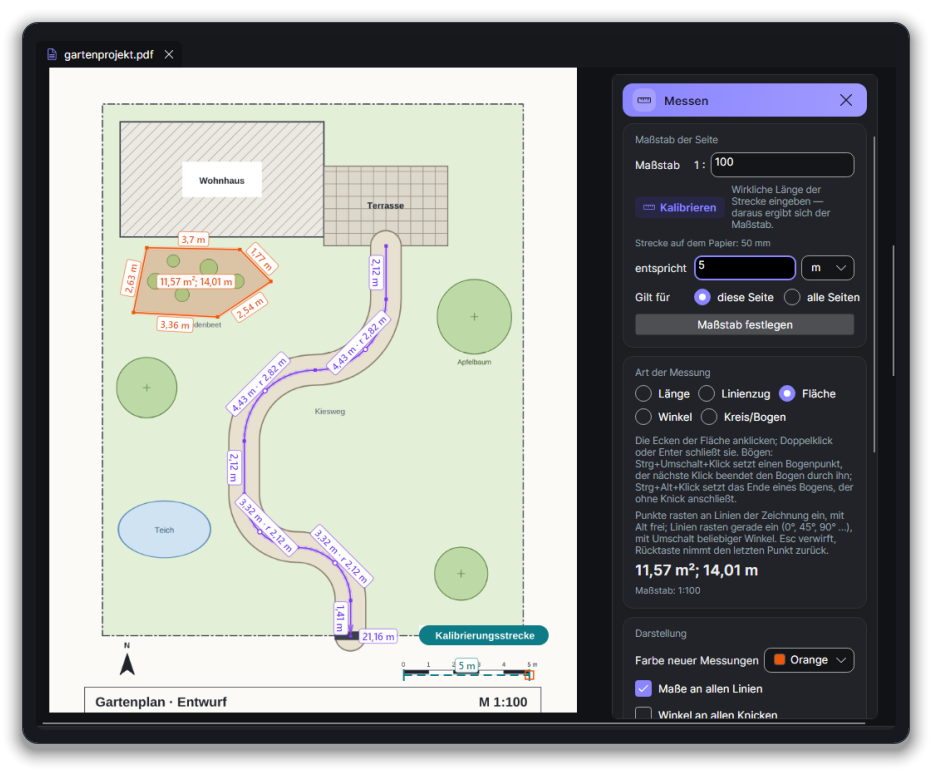

- **Längen, Linienzüge, Flächen mit Umfang, Winkel, Kreise und Bögen** – am Bogen steht sein Radius, die Fläche rechnet die Kreisabschnitte mit.
- **Mit dem Maßstab der Datei** (ISO 32000-2) oder selbst kalibriert: Anfang und Ende einer bekannten Strecke mit der Lupe setzen, Länge
  eingeben. Der Maßstab wird in die Seite geschrieben, damit andere Programme dasselbe messen.
- **Genau gesetzt:** Punkte rasten an Ecken und Linien der Zeichnung ein, gerade Linien bei 0°, 45° und 90°.
- **Als Bemaßung gespeichert** nach der PDF-Norm – mit Pfeilen nach ISO 129-1, später wieder verschiebbar, auch in Bemaßungen anderer Programme.

### Druckvorstufe: Überdrucken sehen

  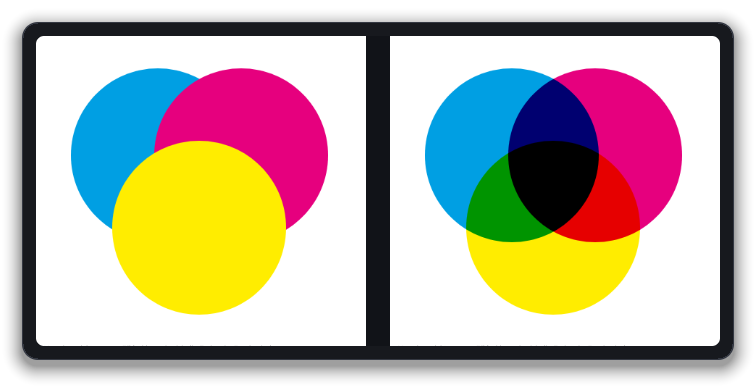

Was im Druck übereinanderliegt, mischt sich – am Bildschirm sieht man es normalerweise nicht. Die **Überdrucken-Vorschau** im Reiter
„Ansicht“ zeigt es (links aus, rechts an). Dazu Transparenzgruppen, Masken, Mischmodi und Verläufe nach der PDF-Norm.

### Drucken als Broschüre

  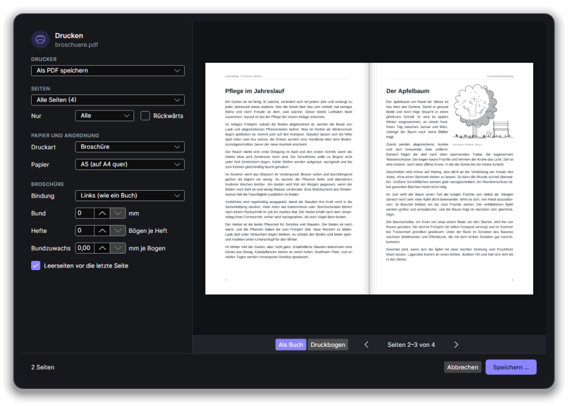

- **Broschüre** mit Buchvorschau zum Umblättern: aus A4-Bögen wird ein A5-Heft, mit Bund, Bindung links oder rechts und Heften für dicke
  Broschüren.
- **Poster** über mehrere Blätter, **mehrere Seiten pro Blatt** – vorher sehen, was aus dem Drucker kommt.

### Schriften der Welt, Sprachen nach Wahl

- **Chinesisch, Japanisch, Koreanisch:** PDF-Knead zeigt CJK-Dokumente – auch senkrecht gesetzten Text und Dateien ohne eingebettete
  Schrift. Die vordefinierten CMaps der Norm sind im Programm, Noto Sans CJK und Noto Serif CJK liegen bei.
- **Auch beim Schreiben:** Chinesische, japanische und koreanische Zeichen lassen sich über die Eingabehilfen von Linux und Windows
  tippen. Gespeichert wird nur eine kleine Teilschrift mit den Zeichen, die wirklich vorkommen.
- **Die Oberfläche in Ihrer Sprache:** Deutsch und Englisch sind eingebaut. Jede weitere Sprache ist eine JSON-Datei: Vorlage
  exportieren, übersetzen, in den Ordner `languages` legen – schon steht sie in der Auswahl, mit Einzahl und Mehrzahl, Zahlen- und
  Datumsformaten. Was noch nicht übersetzt ist, erscheint auf Englisch.

---

## Ihr Rechner. Ihre Daten.

- **Lokal:** Anzeigen, Bearbeiten, Schwärzen, Komprimieren, PDF/A und Texterkennung laufen auf Ihrem Rechner.
- **KI ohne Cloud:** Die KI-Modelle für Texterkennung (PP-OCRv6) und Felderkennung (FFDetr) liegen im Paket und rechnen direkt auf Ihrem
  Rechner, über ONNX Runtime mit abgeschalteter Telemetrie. Es gibt keinen KI-Dienst, kein Konto und kein Nachladen: Ihre Dokumente,
  Seitenbilder und erkannten Texte verlassen den Rechner nicht.
- **Still:** keine Telemetrie, kein Konto, Updates nur, wenn Sie es wollen – auch die Telemetrie mitgelieferter Bibliotheken ist im
  Programm abgeschaltet.
- **Kein fremder Code:** JavaScript in PDFs wird nie ausgeführt; Formularberechnungen rechnet PDF-Knead selbst nach.
- **Keine alten Fassungen:** Gespeichert wird vollständig neu – außer bei signierten Dokumenten, an die erlaubte Änderungen angehängt werden.

&nbsp; <b>Wann PDF-Knead ins Netz geht – und nur dann</b>

**Grundsatz:** PDF-Knead baut von sich aus keine Verbindung auf. Ins Netz geht es nur für die folgenden Funktionen – und nur, wenn Sie sie
auslösen oder einschalten.

**Suche nach Updates** 
*Wann:* nur, wenn Sie sie einschalten (Vorgabe: aus; beim ersten Start fragt PDF-Knead einmal), dann beim Start höchstens einmal am Tag;
von Hand jederzeit. In Verwaltungen kann die IT sie zentral abschalten. 
*Was:* nur die Abfrage einer Versionsdatei bei GitHub – GitHub sieht dabei die Adresse Ihres Anschlusses, den Zeitpunkt und den
Programmnamen mit Version, nichts über Sie oder Ihre Dokumente. Ein Update wird erst nach Ihrem Klick geladen und nur installiert, wenn
seine Signatur stimmt.

**Zeitstempel beim Signieren** 
*Wann:* nur, wenn Sie ihn einschalten (Vorgabe: aus). 
*Was:* allein die Prüfsumme der Signatur – nicht das Dokument.

**Langzeitprüfung und Archiv-Zeitstempel** 
*Wann:* nur, wenn eingeschaltet oder auf Klick. 
*Was:* Abfragen des Sperrstatus an die Adressen aus den Zertifikaten; für den Archiv-Zeitstempel wieder nur eine Prüfsumme.

**EU-Vertrauensliste** 
*Wann:* nur auf Klick. 
*Was:* Abruf der öffentlichen Listen der EU und der Mitgliedstaaten.

**Links aus PDFs und QR-Codes** 
*Wann:* nur nach Ihrer Rückfrage. 
*Was:* Die Adresse öffnet Ihr Standardbrowser; PDF-Knead selbst verbindet sich nicht.

---

## Und alles, was man täglich braucht

| | |
|---|---|
| **Ansehen** | schnelle Anzeige auch großer Baupläne, Suche, Lesezeichen, Notizen, Bildinfo, helles und dunkles Design |
| **Seiten** | per Ziehen sortieren, drehen, löschen, Leerseiten einfügen – mit Rückgängig |
| **Bearbeiten** | vorhandenen Text ändern, Text, Bilder, Formen und Notizen einfügen, Bilder der Seite verschieben und zuschneiden |
| **Unterschreiben** | Handschrift-Schriften, gezeichnet oder als Bild, auf Wunsch mit Kugelschreiber-Struktur |
| **Texterkennung** | gescannte Seiten durchsuchbar, lokal; rund 97 % der Wörter richtig gelesen (gemessen an Scanseiten) |
| **Drucken** | mehrere Seiten pro Blatt, Broschüre mit Buchvorschau, Poster über mehrere Blätter |
| **Messen** | Längen, Flächen, Winkel und Radien mit Maßstab, als Bemaßung speichern |
| **Scannen** | Scanner unter Linux und Windows, Seiten aufbereiten, Texterkennung |
| **Sichern** | Dokument bereinigen, Flachlegen, als Bild sichern |
| **Kommandozeile** | viele Funktionen auch als `pdf-knead` |

---

## Geprüft, nicht behauptet

  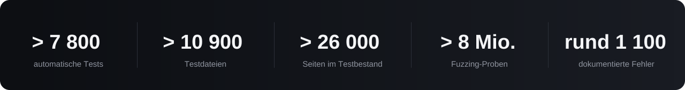

Dazu gleichen wir den Code Satz für Satz mit den Normen ab, zuerst ISO 32000-2: Zu jeder Pflicht gehören eine Stelle im Code und ein
Test. Was eine Datei enthält und PDF-Knead nicht versteht, bleibt beim Speichern unverändert – damit das Programm, das es geschrieben hat,
weiter damit arbeiten kann.

Jeder abgenommene Meilenstein endet mit einer Analyserunde: Sicherheit, Speicher, Funktion, Leistung – und Bedienung mit echten
Maus- und Tastaturereignissen. Jeder gefundene Fehler wird festgehalten: Ursache, Lösung, was man
nicht tun sollte, und der Test, der ihn absichert.

**Gegengeprüft mit unabhängigen Werkzeugen:**

- **[veraPDF](https://verapdf.org)** – PDF/A und PDF/UA. Was PDF-Knead als PDF/A speichert, prüfen wir mit dem Prüfprogramm von veraPDF nach:
  In allen elf Fassungen (1a bis 4f) über rund 3 300 Dateien aus öffentlichen Testbeständen — zusammen etwa 37 000 Kopien — lehnt es keine
  ab. Auf den Testdateien von veraPDF (PDF/A-2b) lehnt unsere eigene
  Prüfung keine der 377 gültigen Dateien ab und erkennt alle 609 ungültigen.
- **[EU DSS](https://github.com/esig/dss)** (Digital Signature Service der Europäischen Kommission) – digitale Signaturen. Unsere
  Signaturprüfung läuft über die 251 PDF-Prüfdateien von DSS, die Ergebnisse vergleichen wir je Datei mit denen von DSS. Von PDF-Knead
  signierte Dateien erkennt DSS als gültig an.
- **[Arlington PDF Model](https://github.com/pdf-association/arlington-pdf-model)** der PDF Association – das maschinenlesbare Modell
  der PDF-Norm. Alles, was PDF-Knead schreibt (Speichern, Komprimieren, PDF/A, Formulare, Signieren, Schwärzen), prüfen wir mit dessen
  Prüfprogramm gegen das Modell.
- **[qpdf](https://github.com/qpdf/qpdf)** – Dateiaufbau. Querverweise, Objektströme, Nachträge, Filter und Verschlüsselung der
  geschriebenen Dateien prüfen wir zusätzlich mit qpdf als zweitem, unabhängigem Leser.
- **[KoSIT-Prüfwerkzeug](https://github.com/itplr-kosit/validator)** mit der XRechnung-Konfiguration und die
  **[Prüfregeln der EN 16931](https://github.com/ConnectingEurope/eInvoicing-EN16931)** – E-Rechnung. Schema und Regeln unserer Prüfung
  vergleichen wir je Rechnung mit diesen Referenzen: über 14 000 abgewandelte Rechnungen ohne abweichendes Urteil. Für Rechnungen nach
  EN 16931-1:2026 steht die Vorabfassung der KoSIT-Konfiguration mit dem Schema UBL 2.5 bereit; Prüfregeln für 2026 gibt es öffentlich
  noch nicht.
- **[Mustang](https://www.mustangproject.org)** – ZUGFeRD und Factur-X: PDF/A-3 und eingebettetes XML als zweite Gegenprobe.
- **[ZXing](https://github.com/zxing/zxing)** – Strichcodes. Jede der 14 Code-Arten, die PDF-Knead erzeugt, liest ZXing in vier
  Drehungen mit genau dem erwarteten Inhalt.
- **[PAC](https://pac.pdf-accessibility.org)** – Barrierefreiheit nach PDF/UA und dem Matterhorn-Protokoll, als zweiter Prüfer neben veraPDF.

Die Namen gehören ihren Inhabern. Die Projekte haben PDF-Knead weder geprüft noch empfohlen – wir nutzen ihre freien Werkzeuge, um
unsere eigene Arbeit zu prüfen.

&nbsp; <b>Was an beschädigten und präparierten Dateien abgefangen wird</b>

Was PDF-Knead öffnet, kann beschädigt oder absichtlich präpariert sein. Das fängt es ab:

**Kaputte Dateistruktur** 
Beschädigte Querverweise werden beim Öffnen repariert; Kreise in Objekten, Seitenbäumen, Masken und Glyphen werden erkannt.

**Daten- und Speicherbomben** 
Grenzen für Verschachtelung, für entpackte Datenströme und für Einträge und Suchtext je Seite – eine winzige Datei kann den Rechner nicht
fluten.

**Endlose Seiten** 
Zeitgrenzen für Seiteninhalte, Erscheinungsbilder, Bilder und die Code-Suche.

**Präparierte Schriften** 
Schrittbudgets für Schriftprogramme (CFF, Type 1, TrueType) und das Schrift-Layout.

**Präparierte Bilder** 
Grenzen für JBIG2, JPEG 2000, CCITT und PNG; ganzzahlige Überläufe abgefangen; Stapelüberläufe durch tiefe Rekursion verhindert.

**Eingeschleuste Befehle** 
Formularwerte gelangen nur maskiert in Skripte; Verweise auf andere Dateien und Netzpfade entfernt „Dokument bereinigen“.

**Angriffe auf Signaturen** 
Bekannte Angriffsklassen, schwache Verfahren, begrenzte Zahl und Größe je Prüfung.

**XML und Metadaten** 
Ohne DTD und externe Entitäten; die Vertrauenslisten werden gegen Umhüllung der Signatur geprüft.

**Dateien, die sich unter der Hand ändern** 
Wird eine geöffnete Datei von außen gekürzt oder überschrieben, bemerkt PDF-Knead das und fragt nach.

&nbsp; <b>Gemessene Leistung</b>

Gemessen auf dem Entwicklungsrechner; die Werte hängen von Rechner und Dokument ab. Vergleiche mit anderen Programmen stellen wir nicht an.

**Programmstart** 
Erstes Bild nach rund 0,3 s.

**Großer Bauplan** 
Ein Plan im Format A0 mit rund 780 000 Linien ist beim ersten Öffnen in gut 1 s aufbereitet und als PDF/A in rund 2 s gespeichert.

**Große Datei signieren** 
200 MB digital signieren: rund 3 s, mit unter einem halben Gigabyte Speicher.

**Schwärzen** 
500 Textseiten: unter einer halben Sekunde, mit Bereinigen des ganzen Dokuments unter 1,5 s.

---

## Loslegen

- **Linux:** die AppImage herunterladen, ausführbar machen, starten. **Windows:** die einzelne `.exe` starten. Keine Installation nötig.
- **Selbst bauen:** `./publish.sh` (Linux) bzw. `publish.ps1` (Windows) mit einem .NET-10-SDK.
- **Texterkennung und Felderkennung mit KI** laufen ganz auf dem Rechner: Die Modelle (PP-OCRv6 small und medium, der Feld-Erkenner
  FFDetr) liegen im Paket im Ordner `ocr` neben dem Programm — es muss nichts nachgeladen werden, und kein Dokument verlässt den Rechner.

**Stand der Entwicklung:** PDF-Knead ist eine Beta.

---

  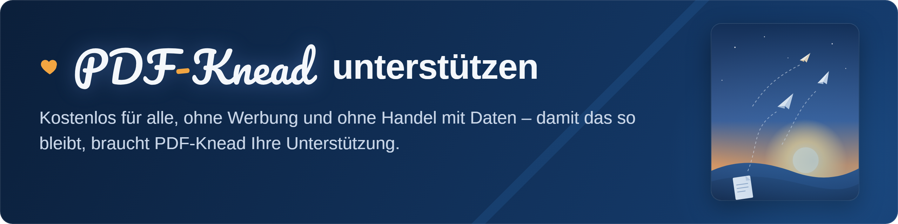

> **Hinter PDF-Knead steht kein Konzern.** Kein Investor, keine Werbung, kein Geschäft mit Ihren Daten – sondern ein Einzelner, mit
> eigener Zeit und eigenem Geld. Dass der Quelltext offen einsehbar ist, heißt nicht, dass er nichts gekostet hat: Jede Prüfung, jeder
> Testlauf über Tausende Dateien, jede Norm, die Satz für Satz gelesen wird, kostet Zeit und Geld. Und manches lässt sich mit Fleiß allein
> nicht ersetzen.

### Was noch fehlt: die Normtexte

PDF-Knead wird Satz für Satz am Normtext abgeglichen – so, wie PDF selbst, PDF/UA und die
Signaturnormen. Für vier Bereiche fehlen die Texte noch; es gibt sie nur zu kaufen:

- **PDF/A – Archivieren**, bei der PDF Association. Heute arbeitet PDF-Knead nach den öffentlichen Regelsammlungen und lässt jede Datei
  von veraPDF gegenprüfen; die Normtexte sind die Quelle jeder dieser Regeln.
  - **[ISO 19005-1:2005 – PDF/A-1](https://pdfa.org/resource/iso-19005-1-pdf-a-1/)**: auf Grundlage von PDF 1.4.
  - **[ISO 19005-2:2011 – PDF/A-2](https://pdfa.org/resource/iso-19005-2-pdf-a-2/)**: auf Grundlage von PDF 1.7 (ISO 32000-1).
  - **[ISO 19005-3:2012 – PDF/A-3](https://pdfa.org/resource/iso-19005-pdfa/)**: PDF/A-2 mit eingebetteten Dateien – die Grundlage von
    ZUGFeRD und Factur-X.
  - **[ISO 19005-4:2020 – PDF/A-4](https://pdfa.org/resource/iso-19005-4-pdf-a-4/)**: auf Grundlage von PDF 2.0 (ISO 32000-2).
- **E-Rechnung nach der Fassung 2026**, bei DIN Media. Seit 2026 gilt ein überarbeitetes Datenmodell der europäischen E-Rechnung,
  XRechnung 4.0 wird es in Deutschland umsetzen; PDF-Knead erkennt solche Rechnungen schon, prüft sie aber noch nach den Regeln von 2017.
  - **[DIN EN 16931-1:2026-10 – Semantisches Datenmodell der elektronischen Rechnung](https://www.dinmedia.de/de/norm/din-en-16931-1/400613286)**:
    die Kernelemente jeder E-Rechnung, unabhängig vom Format.
  - **[DIN CEN/TS 16931-3-3 – Syntaxbindung an UN/CEFACT CII](https://www.dinmedia.de/en/pre-standard/din-cen-ts-16931-3-3/308617415)**:
    wie das Datenmodell in CII steht – die Grundlage von ZUGFeRD, Factur-X und XRechnung in CII. Die Ausgabe 2026 ist bei DIN Media noch
    nicht als deutsche Fassung gelistet; der Link führt zur bisherigen.
- **Farbräume von Bildern**, bei IEC und ISO. JPEG-2000-Bilder in PDF nennen ihren Farbraum oft nur mit einer Kennzahl; was diese genau
  bedeutet, steht in eigenen Normen. PDF-Knead rechnet sie heute nach den frei zugänglichen ITU-Empfehlungen und den Angaben aus JPEG 2000;
  scRGB-Grau bleibt ohne den Normtext unbeachtet, statt geraten zu werden.
  - **[IEC 61966-2-1:1999 – sRGB](https://webstore.iec.ch/en/publication/6169)** mit **[Änderung 1:2003 – sYCC](https://webstore.iec.ch/en/publication/6168)**:
    der Standard-Farbraum fast aller Bilder und seine erweiterte YCC-Fassung.
  - **[IEC 61966-2-2:2003 – scRGB](https://webstore.iec.ch/en/publication/6171)**: linearer RGB-Farbraum mit erweitertem Umfang.
  - **[ISO 22028-2:2013 – ROMM RGB](https://www.iso.org/standard/56591.html)**: der weite Farbraum der Druck- und Fotowelt.
- **Strichcodes**, bei ISO. PDF-Knead liest und erzeugt QR, Data Matrix, Code 128, EAN/UPC, Code 39 und ITF und prüft heute gegen die
  frei zugänglichen GS1-Spezifikationen; die Symbologie-Normen legen Aufbau, Maße und Prüfregeln jedes Codes fest.
  - **[ISO/IEC 18004:2024 – QR-Code](https://www.iso.org/standard/83389.html)**
  - **[ISO/IEC 16022:2024 – Data Matrix](https://www.iso.org/standard/80926.html)**
  - **[ISO/IEC 15417:2007 – Code 128](https://www.iso.org/standard/43896.html)** mit **[Änderung 1:2026](https://www.iso.org/standard/87124.html)**
  - **[ISO/IEC 15420:2025 – EAN/UPC](https://www.iso.org/standard/84892.html)**
  - **[ISO/IEC 16388:2023 – Code 39](https://www.iso.org/standard/77799.html)**
  - **[ISO/IEC 16390:2007 – Interleaved 2 of 5 (ITF)](https://www.iso.org/standard/43898.html)**

### Warum diese Normen wichtig sind

Was Behörden, Gerichte und Archive heute als PDF/A ablegen, muss in dreißig Jahren noch genauso aussehen wie am ersten
Tag, und eine E-Rechnung muss nach den Regeln geprüft werden, die für sie gelten. Farben sollen so erscheinen, wie sie gemeint sind, und
ein eingefügter Code muss an jeder Kasse und jedem Scanner lesbar sein.

  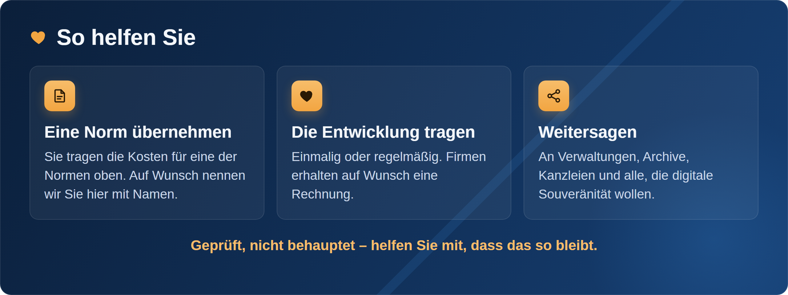

<b>Rechnung, Normpatenschaft oder Fragen:</b> <a href="mailto:pdf-knead@tuta.io">pdf-knead@tuta.io</a>

Der Weg zum Unterstützen folgt in Kürze an dieser Stelle. Bitte keine Normtexte zusenden: Sie sind für eine Person lizenziert, und PDF-Knead arbeitet nur mit rechtmäßig erworbenen Texten.

---

## Technik

- **Oberfläche:** [Avalonia](https://avaloniaui.net) – eine Oberfläche für Linux und Windows, hell und dunkel.
- **Plattform:** C# und .NET 10; auf dem eigenen System als vorab übersetztes Programm (Native AOT) für einen schnellen Start.
- **Eigener Kern:** Parser, Renderer (Transparenzgruppen, Masken, Verläufe), Writer, Schriften (TrueType, OpenType, CFF, Type 1, Type 3,
  CID, Farbschriften) mit eigenem Text-Shaper, Filter (Flate, LZW, CCITT, JBIG2, JPEG 2000, Brotli), Verschlüsselung, ICC-Farbmanagement,
  QR- und Strichcodes, PKCS#11. Gezeichnet wird über SkiaSharp.
- **Pakete:** Linux x64 als AppImage, Windows x64 als einzelne `.exe`.

## Lizenz

Der Quelltext von PDF-Knead ist offen einsehbar, und PDF-Knead ist kostenlos – für alle, mit allen Funktionen, auch in Firmen, Behörden, Schulen und Vereinen. Nicht erlaubt
ist nur, PDF-Knead oder Teile davon zu verkaufen oder gegen Geld weiterzugeben. Maßgeblich ist allein der Text in [LICENSE](LICENSE). Für
mitgelieferte Bestandteile gelten deren Lizenzen ([THIRD-PARTY-NOTICES.md](THIRD-PARTY-NOTICES.md)).

---

PDF ist eine offene Norm (ISO 32000). Adobe ist eine Marke der Adobe Inc.; PDF-Knead steht in keiner Verbindung zu Adobe. Linux ist
eine Marke von Linus Torvalds, Windows eine Marke der Microsoft Corporation. Weitere genannte Namen können Marken ihrer Inhaber sein. Alle
Bilder zeigen selbst erzeugte Beispieldokumente mit erfundenen Inhalten; Grafiken und Schrift (Liberation Sans, SIL OFL) stammen aus dem
Projekt. Angaben ohne Gewähr; es gilt die Lizenz in LICENSE.
